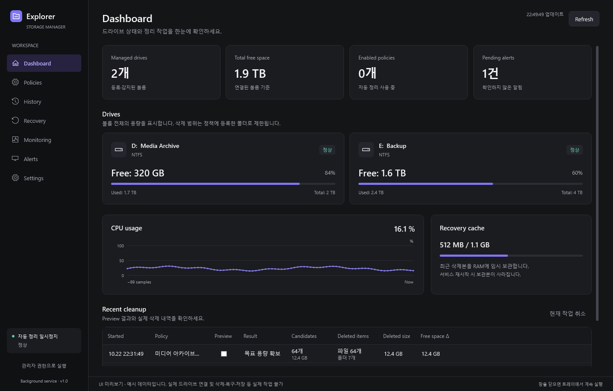
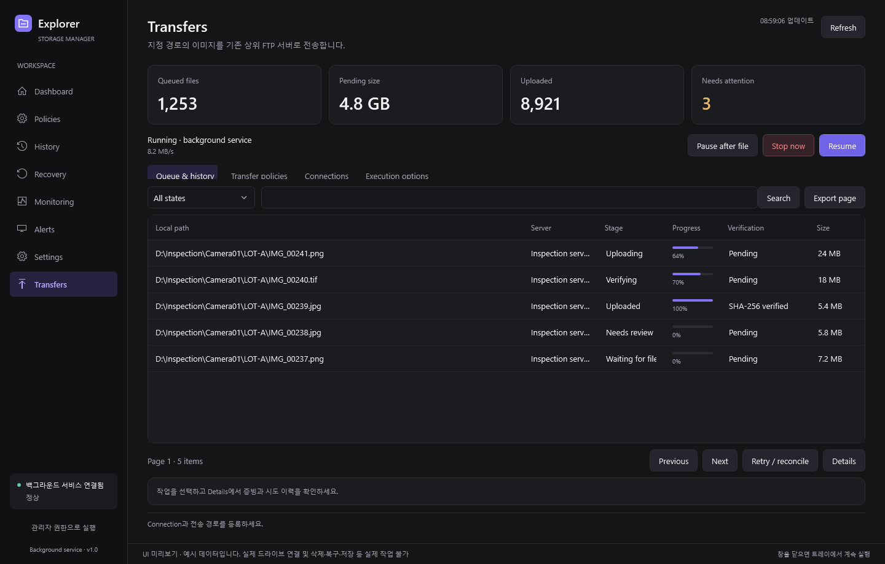

# Explorer Manager

여러 NTFS 드라이브를 감시하고 용량 기준을 넘으면 보관 기간이 지난 파일을 오래된 순서로 정리하는 Windows 프로그램입니다.

## 화면

Dashboard·Policies·History·Recovery·Monitoring·Alerts·Settings·Transfers 메뉴로 구성했습니다. 메뉴와 기술 레이블은 영어, 설명과 삭제·복구 확인 문장은 한국어로 자연스럽게 혼용합니다. 아래는 실제 WPF 컨트롤을 예시 데이터로 렌더링한 화면입니다. 표시된 드라이브·기록·센서 값은 운영 데이터가 아닙니다.



[Policies](docs/images/policies.png) · [Monitoring](docs/images/monitoring.png) · [Settings](docs/images/settings.png) · [Transfers](docs/images/transfers.png) · [UI 설계](docs/02-design/features/ui-refresh.design.md) · [검증 결과와 패키지](https://github.com/dmjeong/HardDisk-Manager/actions/runs/40428806793)

## 실행 구성

- WPF · .NET Framework 4.8 · x64 · MVVM
- Windows Service: 스케줄, 삭제, 감사 이력, 전역 RAM 복구 캐시, 백그라운드 이미지 전송
- Desktop: 정책, 미리보기, 실행 상태, 이력/CSV, 복구, 알람, 트레이, FTP/FTPS 설정과 대기열
- SensorHost: CPU/디스크 센서 수집과 장애 격리. 기본 설치는 읽기 전용 LocalSystem 센서 서비스도 등록
- Named Pipe: 관리자 인증, 로컬 전용, 요청 중복 실행 방지
- SQLite: 정책·삭제 저널·알람·성능 집계·영속 전송 대기열과 검증 증빙

## 설치

Windows 11 x64 또는 Windows Server 2022/2025 Desktop Experience와 .NET Framework 4.8 이상이 필요합니다.

1. [Actions](https://github.com/dmjeong/HardDisk-Manager/actions)에서 성공한 실행의 `ExplorerManager-win-x64` artifact를 받습니다.
2. 그 안의 `ExplorerManager-win-x64.zip`을 완전히 압축 해제합니다.
3. **Setup.cmd를 더블클릭**하고 Windows 권한 확인창을 승인합니다. 신규 설치와 기존 버전 업데이트 모두 같은 방법을 사용합니다. 실행 중인 설치본 Desktop을 닫고 프로그램과 서비스를 함께 교체하며 정책·설정·이력은 유지합니다. 서비스 재시작으로 RAM 복구본은 소멸하므로 필요한 파일은 먼저 복구하세요. 관리자 PowerShell의 `./Install.ps1`도 지원합니다.
4. Policies의 **Grant access…**로 관리 폴더에 서비스 권한을 부여하거나 실행합니다: `./Grant-ManagedRoot.ps1 -Path 'D:\Archive'`.
5. WPF 앱은 실행 시 필요한 관리자 권한을 요청합니다. **Save policy → Preview → 결과 확인 → 자동 정리 활성화** 순서로 설정합니다.

삭제 서비스 이름은 `ExplorerManager`(전용 가상 계정), 하드웨어 센서 서비스는 `ExplorerManagerSensors`(LocalSystem)입니다. 센서 서비스는 측정값만 제공하며 삭제·프로세스 종료 명령을 받지 않습니다. `Install.ps1 -NoHardwareSensors`로 관리자 센서를 제외할 수 있습니다.

데이터는 `%ProgramData%\ExplorerManager\Data`입니다. X 또는 Exit는 Desktop 프로세스를 종료합니다. Hide to tray는 창만 숨기며, 어느 쪽이든 Windows Service는 별도로 계속 실행됩니다. 기본 설치는 설치한 운영자 계정의 로그인 시 UI를 관리자 권한으로 실행하는 작업을 등록합니다.

자동 삭제는 설치 직후 비활성 상태입니다. 수동 정리도 용량·기간·보호 규칙을 그대로 적용합니다. NAS/UNC, USB 자동 정리, ReFS는 v1 대상에 포함하지 않습니다.

Desktop과 Service 버전은 왼쪽 아래에 표시합니다. 버전이 다르면 **서비스 업데이트** 안내가 나오며, 새 패키지의 Desktop에서 업데이트를 실행할 수 있습니다. 설치 실패·앱 오류 기록은 **Diagnostics logs** 또는 `%LocalAppData%\ExplorerManager\Logs`에서 확인합니다.

## 삭제 규칙

볼륨별로 여러 관리 루트를 등록할 수 있습니다. 사용률(예: 90% 시작/85% 중단), 사용 바이트, 최소 여유 바이트 중 한 가지를 선택합니다. 관리 루트 바로 아래 폴더와 그 하위 경로를 한 작업 단위로 묶습니다. 가장 오래된 삭제 대상이 있는 폴더부터 선택하며, 폴더 안에서도 오래된 대상부터 처리합니다. 루트 바로 아래 파일은 각각 독립 단위입니다. 매 항목 전후에 실제 여유 공간을 다시 측정하고, 목표 용량에 도달하면 진행 중인 폴더의 삭제 가능 항목과 비게 된 오래된 하위 폴더까지 정리한 뒤 중단합니다. 따라서 최종 확보량은 목표를 초과할 수 있습니다.

기본 보관 기준은 마지막 수정 시각 30일이며 생성 시각으로 변경할 수 있습니다. 최근 파일·제외 경로·복구 보호 대상은 유지합니다. 파일을 검증·삭제한 뒤 빈 폴더를 제거하며 등록 루트는 삭제하지 않습니다. 보호되거나 잠긴 파일이 남은 폴더는 유지됩니다. 취소·장치 이상·부하·정책 변경·실행 시간대와 작업 상한은 폴더 처리 중에도 적용합니다. 잠금 알람의 Retry는 지정 파일만 처리하며 주변 파일과 상위 폴더를 삭제하지 않습니다. 경로와 파일 ID를 확인한 동일 핸들에서 복사·삭제하여 교체 경합을 차단합니다.

링크, junction, reparse point, 다중 hard link, ADS, 암호화·압축·sparse·숨김·시스템·읽기 전용 파일 등 미지원 특수 항목은 스킵합니다. 전체 스캔을 완료하지 못하면 부분 목록으로 삭제하지 않습니다.

삭제는 WPF와 분리된 Windows Service의 백그라운드 작업에서 수행합니다. 여러 드라이브 작업은 직렬화하며, 기본 읽기 제한은 10 MiB/s입니다. RAM 복사·SHA-256 검증·파일별 감사 기록 비용이 있어 실제 속도는 파일 크기와 HDD 성능에 따라 달라집니다.

## Interlocks와 운영 옵션

Dashboard의 Interlocks에서 현재 차단 사유와 상태를 확인합니다. RAM 부족은 감지 즉시, CPU·온도·활성 디스크 I/O 지연은 설정한 Trip delay 후 정리를 차단합니다. 지정 앱이 실행 중이거나 서비스의 측정이 오래되면 정리를 차단하고 진행 중인 캐시 복사를 취소합니다. 원본은 삭제 전에 조건을 다시 확인합니다.

Settings에서 RAM reserve, Trip/Recovery delay, 수동 Reset 유지, 정리를 차단할 앱을 지정합니다. 트립된 조건은 안전한 측정이 Recovery delay 동안 유지되어야 해제됩니다. 측정 누락은 정상으로 간주하지 않으며 래치가 서비스 재시작 뒤에도 유지됩니다. Reset/Resume는 현재 위험 조건·필수 감사/캐시 검증·Critical 디스크 알림을 우회하지 않습니다. 복구 작업은 별도로 사용할 수 있습니다.

Locked file notifications는 Popup / Tray notification / Log only와 최소 알림 간격을 선택합니다. 알림 방식을 바꿔도 Alerts와 로그를 유지하고 프로세스를 자동 종료하지 않습니다. History retention에서 보관 일수와 DB 용량 상한을 설정합니다. 보관 중인 복구본·삭제 준비·미해결 알림은 용량 정리에서 보호합니다.

Policies의 Schedule에서 요일과 HH:mm을 지정합니다. 자정을 넘는 구간은 시작 요일에 속하며 종료 시각은 제외합니다. 예를 들어 금요일 22:30–06:15는 토요일 06:15 직전까지 실행합니다. 기존 정책은 매일과 기존 시간값을 유지합니다.

## RAM 복구 캐시

삭제 전에 파일 전체를 서비스 메모리에 복사하고 SHA-256을 검증합니다. 모든 드라이브가 하나의 RAM 보관 예산을 공유하며 메타데이터와 블록 비용도 포함합니다. 기본값은 1 GiB입니다. Settings → Recovery cache → RAM limit (MiB)에서 1~16,384 MiB 범위로 수정하고 Save changes로 저장합니다. 정리·Preview·복구 작업이 없을 때 재시작 없이 적용되며 다음 서비스 시작에도 저장값을 사용합니다. 한도를 늘리면 기존 복구본을 유지하고 메모리를 미리 전부 할당하지 않습니다. 줄이면 초과분을 오래된 복구본부터 제거하므로 해당 항목은 복구할 수 없습니다. 단일 파일 전체와 메타데이터가 설정 예산에 들어가지 않으면 스킵합니다.

최근 복구본만 FIFO로 유지합니다. 이전 복구본 퇴출, 서비스 재시작/중지, PC 종료 뒤에는 복구할 수 없습니다. WPF 창만 닫는 경우에는 캐시가 유지됩니다. 파일 본문을 복구용 디스크 파일로 보관하지 않지만 일반 메모리는 OS 페이지 파일 등에 기록될 수 있습니다.

복구는 기존 파일을 덮어쓰지 않고 충돌 시 새 이름을 사용합니다. 본문·생성/수정 시각·지원 DACL을 복원하고 24시간 재삭제 보호를 적용합니다. 원래 소유자·감사 ACL 등 모든 NTFS 메타데이터를 완전 재현하는 기능은 제공하지 않습니다.

## 잠금과 강제 종료

잠금 파일은 스킵하고 이력과 알람을 남깁니다. 알람에는 **강제 종료 후 삭제하시겠습니까?**를 표시합니다. 종료는 Settings의 Process allowlist에 등록한 앱 중 현재 운영자 소유·동일 세션의 일반 앱만 지원합니다. 프로세스 시작 시각과 실제 핸들을 확인하며 필수·보호·서비스 프로세스는 제외합니다. 권한 거부와 잠금을 구분합니다.

## 모니터링

CPU 사용률, 가용 RAM, 볼륨 용량, 디스크 읽기·쓰기 처리량/IOPS/지연/큐, 지원 온도·건강 지표, Windows 저장장치 오류를 수집합니다. 센서 미지원·권한 부족은 N/A 상태로 표시합니다. 온도 임계값은 장비에 맞게 설정해야 합니다. 유휴 상태의 0B/s를 장애로 판정하지 않습니다.

센서 드라이버가 보안 정책에 의해 차단되면 해당 센서를 사용할 수 없습니다. OS 보안 설정을 자동으로 낮추지 않습니다.

## 이미지 전송

**Transfers**에서 지정 경로의 이미지를 기존 FTP/FTPS 서버에 전송합니다. 수신 프로그램 변경이나 별도 서버 설치는 필요하지 않습니다. Explicit/Implicit FTPS와 명시적으로 선택하는 Plain FTP, UTF-8/CP949 인코딩, EPSV/PASV, 원본 이름·하위 폴더 유지, 자동 감지·스케줄·수동 backfill을 지원합니다. TCP 전용 수신기는 실제 framing·파일명·완료 응답 규격이 있어야 추가할 수 있습니다.

1. **Connections → New → Save**에서 주소·포트·계정·암호화 방식을 저장합니다. **Set password**로 비밀번호를 별도 등록합니다. 비밀번호는 서비스가 DPAPI로 암호화해 보관합니다.
2. **Test connection**으로 로그인하고, 상위 수신기가 감시하지 않는 전용 시험 폴더에서 **Test upload**를 실행합니다. 읽기 검증·APPE 이어 보내기·rename이 가능한지 실제로 시험하고 시험 파일만 제거합니다.
3. **Transfer policies → New**에서 로컬 NTFS 루트, Connection, 원격 최종·staging 경로를 지정합니다. 상위 서버에 원격 루트와 staging 폴더를 미리 만들어 두고 권한을 부여합니다. 서비스 계정에는 로컬 이미지 읽기 권한이 필요합니다.
4. **Preview**로 범위를 확인합니다. 수신기의 임시 이름/staging 처리 방식과 장비별 독립 목적지 또는 고유 파일명을 확인한 뒤 해당 체크 항목과 **Enabled**를 선택해 저장합니다. **Queue & history**에서 진행·시도·검증 수준을 확인합니다.

기본은 임시 업로드 → 원격 SHA-256/RETR read-back 검증 → 최종 경로 rename입니다. 검증된 성공 파일만 기존 정리 조건에 따라 삭제할 수 있고, 삭제 직전 RAM 복구본의 SHA-256과 증빙을 다시 비교합니다. 검증 전·전송 중·결과 불명·내용 변경 이미지는 보호합니다. Pause·Archive·감시 누락·서비스 재시작으로 기존 보호가 풀리지 않습니다. 보호가 등록된 원본 루트·대상 서버는 첫 버전에서 변경하거나 보호를 해제할 수 없습니다.

읽기/hash 권한이 없는 서버는 **Independent + Size only**로 업로드할 수 있으나 삭제 보호 성공 증빙으로 사용할 수 없습니다. 업로드된 파일을 수신기가 즉시 소비하고 완료 응답까지 유실한 경우에는 **Needs review / PublicationUnknown**으로 보류합니다. FTP 완료는 상위 업무 처리나 영구 보관을 보장하는 응답이 아닙니다.

기본 worker 2개, 업로드·검증 다운로드·물리 디스크 읽기 각각 10 MiB/s, 안정화 10초, 재검색 300초입니다. 실행 옵션에서 동시성·속도·대기열/시도 한도를 조절합니다. Pause는 현재 작업을 마치고 중단하며 Stop now는 취소 후 재조정합니다. 리소스·감사·디스크 이상 Interlock과 복구 작업은 진행 중 전송도 중단시킵니다. 전송은 고정 버퍼로 스트리밍하며 RAM 복구 예산을 소비하지 않습니다.



[Policies](docs/images/transfer-policies.png) · [Connections](docs/images/transfer-connections.png) · [Execution options](docs/images/transfer-options.png) · [운영 설정·오류 대응](docs/operations.md#이미지-전송-설정과-운영) · [상세 설계](docs/02-design/features/image-transfer.design.md) · [구현과 검증](docs/04-report/image-transfer.report.md)

## 빌드와 검증

Windows에서 Visual Studio 2022의 **.NET 데스크톱 개발** 구성과 **.NET Framework 4.8 SDK/타기팅 팩**을 설치합니다. 모든 프로젝트는 기존 .NET Framework 프로젝트 형식이며, .NET 8 런타임·SDK·타기팅 팩을 요구하지 않습니다. NuGet 패키지는 프로젝트를 처음 열 때 복원합니다.

`ExplorerManager.sln`을 열고 `ExplorerManager.Desktop`을 시작 프로젝트로 지정합니다. F5 빌드는 Service/SensorHost와 Setup 파일도 준비합니다. 서비스가 없으면 실제 로컬 볼륨·CPU·RAM을 읽기 전용으로 보여 주며 **서비스 설치/시작**에서 관리자 실행과 설치를 진행할 수 있습니다. 정책 저장·정리·복구는 서비스 연결 후 동작합니다. 실행 중 서비스에 대한 연결 버튼은 서비스를 재설치하거나 RAM 캐시를 지우지 않습니다.

개발자 PowerShell에서 솔루션 빌드와 .NET Framework 시험을 실행합니다. 시험 실행에는 Visual Studio Test Explorer/Test Tools가 필요합니다.

```powershell
./scripts/Build.ps1
./scripts/Test.ps1
```

예전 버전에서 `net8.0` 참조 오류로 프로젝트가 로드되지 않았다면:

1. Visual Studio에서 솔루션을 닫고 최신 `main`을 받습니다.
2. 이전 `global.json`이 남아 있지 않은지 확인합니다. 최신 버전에는 이 파일이 없습니다.
3. 이전 평가 결과가 남아 있으면 `.vs`와 각 프로젝트의 `bin`·`obj`를 지우고 솔루션을 다시 엽니다.
4. NuGet 패키지 복원 후 다시 빌드합니다. .NET Framework 4.8 **개발 팩**은 런타임과 별개이므로 설치 관리자에서 확인합니다.

솔루션의 모든 앱·라이브러리·시험 대상은 .NET Framework 4.8/x64입니다. CI는 .NET SDK 경로를 비활성화한 상태에서 Framework MSBuild로 빌드하고, 243개 시험, WPF 디자인 시점 참조 평가, 실제 NTFS 삭제·복구, 서비스 설치·IPC·8개 WPF 메뉴와 전송 내부 설정 화면의 기본/최소 크기 및 예시 데이터 렌더45장·제거 시험을 실행합니다. 실행 패키지는 `artifacts/ExplorerManager-win-x64.zip`입니다. 코드 서명은 `Build.ps1 -CertificateThumbprint ...`로 보유 인증서를 지정할 때 적용됩니다. 기본 CI 패키지는 서명되지 않습니다.

## 운영과 문서

- [개발 계획](docs/01-plan/features/explorer-manager.plan.md)
- [기술 설계](docs/02-design/features/explorer-manager.design.md)
- [이미지 전송 개발 계획](docs/01-plan/features/image-transfer.plan.md)
- [기존 FTP/FTPS 서버 연동 상세 설계](docs/02-design/features/image-transfer.design.md)
- [이미지 전송 구현·검증 결과](docs/04-report/image-transfer.report.md)
- [운영 매뉴얼](docs/operations.md)
- [Desktop 1.0.1 기본 동작 수정과 실제 UI 검증](docs/04-report/desktop-reliability.report.md)
- [구현·검증 현황](docs/implementation-status.md)
- [제3자 라이선스](THIRD-PARTY-NOTICES.md)

`Uninstall.ps1`은 서비스를 중지하고 프로그램을 제거하며 정책·이력은 보존합니다. 관리 대상 폴더를 제거하지 않습니다. 서비스 업데이트/중지는 RAM 복구본을 소멸시킵니다.
