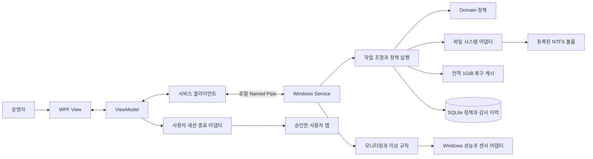
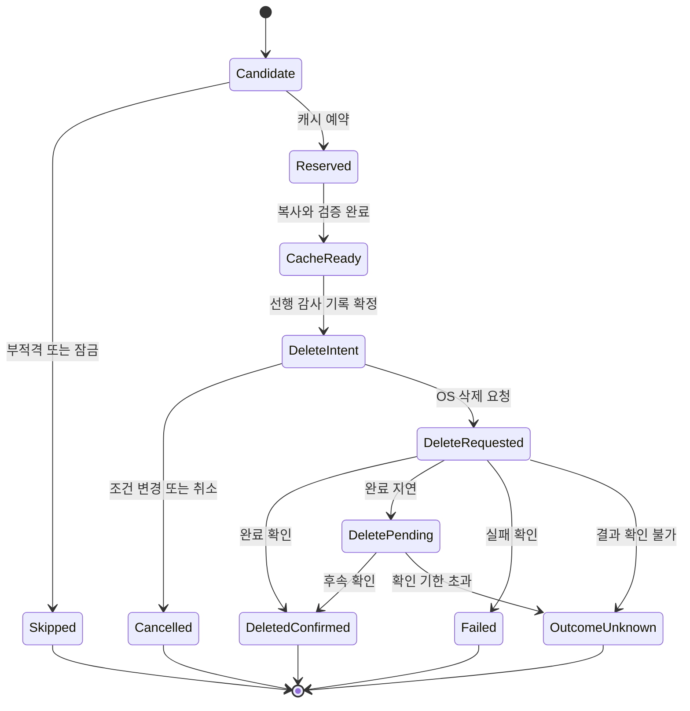

# Explorer Manager 기술 설계안

작성일: 2026-10-21 · 버전: 0.1 · 상태: 설계안 작성 완료, 운영 조건 확인 및 Windows PoC 전

관련 문서: [개발 계획](../../01-plan/features/explorer-manager.plan.md)

Explorer Manager를 WPF·.NET Framework 4.8·x64로 구현하기 위한 구조, 정책 의미, 삭제·복구 절차, 모니터링, 데이터 모델과 검증 기준을 정의한다. 아래 기본값은 제안이며 실제 운영 설정은 대상 장비와 업무 보관 규칙에 맞춰 확정한다.

## 1. 실행 구조



필수 실행 파일은 `ExplorerManager.Desktop.exe`와 `ExplorerManager.Service.exe`이다. 센서 라이브러리의 권한이나 장애 격리가 필요하면 `ExplorerManager.SensorHost.exe`를 추가한다. 서비스와 UI는 동일 버전의 명령 계약을 사용하되 UI가 닫혀도 서비스가 작업과 캐시를 계속 소유한다.

서비스는 Session 0에서 실행하며 팝업을 직접 표시하지 않는다. WPF 앱은 사용자 로그인 시 트레이로 시작하고 알람 이벤트를 받아 창을 표시한다. 사용자가 로그인하지 않은 동안에는 알람을 DB에 저장하고 다음 로그인 시 보여 준다. [Microsoft Interactive Services](https://learn.microsoft.com/en-us/windows/win32/services/interactive-services)

### 1.1 플랫폼과 배포 기준

| 항목 | 설계 |
|---|---|
| 빌드 대상 | .NET Framework 4.8, x64, 기본 언어 버전 C# 7.3 |
| 런타임 | 대상 OS의 4.8 또는 4.8.1, 실제 OS별 검증 |
| UI | WPF, 한국어 기본, 고해상도 DPI 지원 |
| 서비스 | `ServiceBase`, 자동 지연 시작, 장애 시 재시작 정책 |
| DB | SQLite 어댑터, x64 네이티브 종속성을 포함하여 패키지 버전 고정 |
| 로그 | 구조화 회전 파일, Windows Event Log, 삭제 감사 DB |
| 배포 | 서명된 설치 패키지, 서비스·권한·로그인 시작 등록, 이전 설정 마이그레이션 |
| 개발/시험 | Windows의 .NET Framework 개발 팩과 MSBuild, 단위·통합·장비 시험 |

.NET 4.x는 시스템에 하나의 버전이 설치되는 방식이므로 4.8.1이 설치된 장비에 4.8 런타임을 덮어 설치하지 않는다. 빌드 대상 4.8과 설치 런타임을 구분한다. [Microsoft 시스템 요구사항](https://learn.microsoft.com/en-us/dotnet/framework/get-started/system-requirements)

패키지의 최신 버전을 무조건 선택하지 않고 net48 호환 자산·전이 의존성·x64 네이티브 파일을 확인한 버전을 고정한다. 센서 라이브러리와 설치 도구 버전은 P0 결과로 결정한다.

## 2. 솔루션과 MVVM 경계

```text
ExplorerManager.sln
src/
  ExplorerManager.Domain/           정책, 값 객체, 상태, 순수 판단
  ExplorerManager.Application/      작업 흐름, 입출력 인터페이스
  ExplorerManager.Contracts/        IPC DTO, 명령, 이벤트, 프로토콜 버전
  ExplorerManager.Infrastructure/   NTFS, SQLite, PDH/WMI, 캐시, Win32
  ExplorerManager.Service/          ServiceBase, 스케줄러, DI 구성
  ExplorerManager.Client/           Named Pipe 클라이언트, 재연결
  ExplorerManager.Presentation/     ViewModel, 명령, 화면 서비스 인터페이스
  ExplorerManager.Desktop/          WPF View, 리소스, 트레이, UI 어댑터
  ExplorerManager.SensorHost/       필요 시 분리하는 센서 호스트
tests/
  ExplorerManager.Domain.Tests/
  ExplorerManager.Application.Tests/
  ExplorerManager.IntegrationTests/
  ExplorerManager.ArchitectureTests/
installer/
docs/
```

참조 방향은 `Application → Domain`, `Infrastructure → Application + Domain`, `Service → Application + Infrastructure + Contracts`이다. `Presentation → Contracts`, `Client → Contracts`이며 Desktop의 시작 지점에서 ViewModel과 클라이언트·UI 어댑터를 연결한다. Presentation은 WPF Window나 실제 파일 시스템을 참조하지 않는다.

| 계층 | 허용 | 금지 |
|---|---|---|
| View | XAML 바인딩, 스타일, 시각 행동, `InitializeComponent` | 정책 판단, 파일 삭제, DB 조회, 프로세스 종료 |
| ViewModel | 화면 상태, `INotifyPropertyChanged`, `INotifyDataErrorInfo`, `ICommand`, DTO 변환 | `File`/`Directory`/`Process`/SQLite/센서 직접 호출, `MessageBox.Show` |
| Application | 삭제·복구 사용 사례, 권한과 상태 흐름, 인터페이스 호출 | WPF·Windows API 구체 클래스에 대한 의존 |
| Domain | 기간·용량·제외·정렬·상태 전이의 순수 로직 | UI, 타이머, DB, 운영체제 호출 |
| Infrastructure | 파일 핸들, 캐시, DB, 센서, 종료 API 구현 | UI 조작 |

`AsyncCommand`는 중복 실행 방지·실행 상태·예외 전달·취소를 공통 처리한다. `.Result`/`.Wait()`로 UI 스레드를 막지 않는다. 화면 갱신은 `IUiDispatcher`, 창과 확인은 `IDialogService`, 트레이 알림은 `INotificationService`를 통해 UI 어댑터가 수행한다. 이벤트 구독은 화면 종료 시 해제한다.

주요 Application 포트는 다음과 같다.

| 인터페이스 | 책임 |
|---|---|
| `IVolumeCatalog` | 볼륨 식별, 용량, 물리 디스크 매핑 |
| `ICandidateScanner` | 제외 규칙을 적용한 스트리밍 스캔과 후보 저장 |
| `IFileOperationAdapter` | 핸들 확보, 파일 ID 확인, 복사·삭제·복구 |
| `IRecoveryCache` | 전역 예산 예약, 저장, 퇴출, 복구 pin, 무결성 |
| `IAuditRepository` | 삭제 선행 기록, 결과, 알람, 불확정 작업 조정 |
| `ILockInspector` | 잠금 관련 프로세스 후보와 탐지 상태 |
| `IMetricProvider` | 단위와 품질 상태를 포함한 자원 표본 |
| `IClock` | UTC 기준 시각과 테스트 가능한 경과 시간 |

`IUserProcessController`는 사용자 세션 내 인프라 어댑터로 구현하고, ViewModel이 아닌 승인 작업 조정자가 호출한다. 서비스의 승인 티켓과 OS 권한을 확인한 대상만 처리한다.

## 3. 볼륨과 정책 모델

### 3.1 볼륨 식별과 범위

드라이브 문자 `D:`는 표시명이다. `VolumeGuid + VolumeSerial + 장치 식별 정보`로 등록하며 연결이 끊기거나 식별자가 달라지면 정책을 `Offline` 또는 `IdentityMismatch`로 중지한다. 같은 문자를 새 디스크가 차지해도 정책을 자동 승계하지 않는다.

하나의 물리 디스크에 여러 볼륨이 있을 수 있으므로 `PhysicalDisk ↔ Volume`은 다대다로 표현한다. 기본형 로컬 디스크는 매핑하고 RAID/Storage Spaces 등에서 매핑을 확정할 수 없으면 `UnknownTopology`로 표시한다. 확인되지 않은 물리 디스크 값을 특정 볼륨의 건강 상태로 단정하지 않는다.

볼륨당 하나의 활성 정리 정책에 여러 관리 루트를 등록한다. 중복·중첩 루트는 거부한다. v1은 일반적인 대소문자 비구분 NTFS 경로를 대상으로 하며, 대소문자 구분 디렉터리 등 미검증 기능은 지원 상태를 검사하여 스킵한다.

전체 볼륨 사용량을 트리거로 사용하지만 **삭제 범위는 등록 루트 내부**로 제한한다. 루트 밖 데이터 때문에 디스크가 가득 찬 경우에는 목표를 달성하지 못할 수 있다.

### 3.2 정책 필드

| 필드 | 의미 | 기본 제안 |
|---|---|---|
| `PolicyId / Version` | 정책 ID와 변경 버전 | 변경마다 증가 |
| `VolumeIdentity` | 등록 볼륨 식별 | 필수 |
| `ManagedRoots` | 삭제 허용 루트 | 사용자가 지정 |
| `ExcludedPaths / Patterns` | 경로·확장자·이름 제외 | OS/앱/DB/로그/복구 임시 경로 보호 |
| `ThresholdMode` | UsedPercent, UsedBytes, FreeBytes 중 하나 | UsedPercent |
| `StartThreshold / StopThreshold` | 개시·종료 기준 | 90%, 85% |
| `RetentionDays / AgeBasis` | 만료 기간과 시간 기준 | 30일, LastWriteTimeUtc |
| `ScanIntervalSeconds` | 용량과 실행 조건 평가 | 60초 |
| `AllowedWindow` | 정리 가능한 시간대 | 상시, 운영 시 변경 가능 |
| `CooldownSeconds` | 연속 작업 최소 간격 | 300초 |
| `MaxScanSeconds` | 한 볼륨 후보 생성 시간 상한 | 1,800초 제안 |
| `MaxRunSeconds` | 후보 생성 후 삭제 단계 실행 예산 | 300초 |
| `MaxDeletedBytesPerRun` | 한 작업의 논리 삭제량 상한 | 10GiB 제안 |
| `MaxItemsPerRun` | 파일·폴더 시도 상한 | 10,000개 제안 |
| `OversizeAction` | 캐시에 들어가지 않는 파일 | Skip |
| `RestoreProtectionHours` | 복구 파일의 재삭제 방지 | 24시간 |
| `Enabled / DryRun` | 자동 동작과 미리보기 | 비활성 / 미리보기 |

Bytes는 내부 `Int64`, 시각은 UTC로 저장한다. 화면은 GiB/MiB와 원본 바이트를 함께 제공한다. 1GiB 기본값은 1,073,741,824바이트이며 사용자가 십진 1GB를 의도한 경우 상한을 1,000,000,000으로 바꾼다.

### 3.3 임계값 의미

`T = OS가 보고한 볼륨 전체 바이트`, `F = 볼륨 전체 여유 바이트`, `U = T − F`로 계산한다. 사용자별 할당량에 따른 사용 가능 바이트는 별도 표시하고 볼륨 사용률과 혼합하지 않는다.

| 모드 | 시작 | 중단 | 저장 시 검증 |
|---|---|---|---|
| UsedPercent | `100 × U / T >= Start` | `100 × U / T <= Stop` | `0 < Stop < Start <= 100` |
| UsedBytes | `U >= Start` | `U <= Stop` | `0 <= Stop < Start <= T` |
| FreeBytes | `F <= Start` | `F >= Stop` | `0 <= Start < Stop <= T` |

세 모드를 한 정책에서 동시에 적용하지 않는다. 비율과 최소 여유 공간을 결합하는 정책이 필요하면 시작 OR/종료 AND 의미를 별도로 추가한다. v1의 단일 모드로 동작 조건을 명확하게 유지한다.

### 3.4 만료와 정렬

배치 시작 시 `CutoffUtc = RunStartedUtc − RetentionDays × 24시간`을 고정한다. 선택한 파일 시간 `< CutoffUtc`일 때만 만료이며 정확히 경계에 있는 파일은 유지한다. 접근 시각은 기본 기준으로 사용하지 않는다.

정렬 키는 `(AgeUtc ASC, CanonicalRelativePath ASC, FileId ASC)`이다. 같은 볼륨의 모든 등록 루트에서 파일과 이미 비어 있는 적격 폴더 후보를 수집한 뒤 하나의 정렬 목록을 사용한다. DFS 순회 순서로 바로 삭제하지 않는다. 하위 파일을 지운 뒤 새로 빈 폴더는 그때 실행 가능한 후보가 되며 동일한 정렬 규칙에 넣는다. 다른 볼륨 사이에는 전체 정렬을 강제하지 않으며 각각 자신의 용량 목표를 따른다.

대규모 후보는 SQLite 작업 테이블에 저장한다. 처리 상태 인덱스로 아직 처리하지 않은 가장 오래된 후보를 가져오므로, 새로 빈 폴더가 앞선 시각으로 추가되어도 페이지 커서 뒤에서 누락되지 않는다. 정렬 대상은 해당 스캔의 스냅샷이다. 스캔 후 새로 생긴 파일이나 변경된 파일은 다음 스캔에서 다시 판단한다. 삭제 직전 재검증에서 시간·크기·식별자가 달라지면 이번 파일 후보를 스킵한다.

스캔 제한 시간에 도달하여 전체 범위를 확인하지 못했으면 `ScanIncomplete`로 종료하고 부분 목록을 이용해 삭제하지 않는다. 화면에 완료 범위와 소요 시간을 제공하여 스캔 상한·관리 범위를 조정한다. 스캔 시간은 300초 삭제 실행 예산에 포함하지 않는다.

## 4. 삭제 엔진

### 4.1 실행과 동시성

볼륨별 단일 작업 잠금과 물리 디스크별 I/O 제한을 둔다. 기본은 전역 정리 작업 1개이며 서로 다른 물리 디스크에서만 최대 2개까지 설정할 수 있다. 복구 캐시는 병렬 작업도 하나의 전역 예산을 공유한다.

복구는 해당 볼륨의 신규 삭제를 잠시 멈추고 같은 조정자를 통해 실행한다. 하나의 파일을 삭제와 복구가 동시에 처리할 수 없다. 모든 작업은 `CancellationToken`을 전달하며 `Thread.Abort`를 사용하지 않는다. 파일 본문 복사에는 속도 제한을, 메타데이터 스캔에는 항목 수·시간 기반 양보를 적용한다.

시간·삭제량·항목 상한을 넘길 다음 파일은 시작하지 않는다. 개별 파일 크기가 배치 바이트 상한보다 크면 스킵한다. 취소 요청 시 다음 파일을 시작하지 않고, 삭제 요청 전이라면 준비만 취소하고, 삭제 요청 후라면 결과 확인과 감사 기록을 끝낸다.

### 4.2 작업 순서

```text
1. 정책 버전, 볼륨 식별, 시간대, 디스크 상태, 감사 저장소 확인
2. 용량 측정 → 개시 기준 미충족이면 종료
3. CutoffUtc 고정 → 전체 관리 루트 스캔 → 후보 정렬
4. 후보마다:
   a. 취소/정책 변경/상한/볼륨 상태 확인
   b. 실제 여유 공간 측정 → 종료 기준 충족이면 즉시 종료
   c. 제외·만료·복구 보호·경로·파일 ID 재검증
   d. 캐시 수용 가능성 확인 → 단일 항목 초과이면 스킵
   e. 배타 핸들 확보 → 실패 분류, 잠금이면 알람 큐에 추가하고 스킵
   f. 캐시 예산 실제 예약·필요한 FIFO 퇴출 → 실패 시 핸들을 닫고 스킵
      동일 핸들에서 파일 내용·지원 메타데이터를 복사하고 검증
      빈 폴더 후보는 메타데이터를 보관하고 비어 있는지 최종 확인
   g. DeleteIntent를 감사 DB에 확정 저장
   h. 오래 걸린 복사 뒤 용량·정책·취소를 다시 확인
      → 목표 달성 또는 조건 변경이면 원본을 유지하고 준비 취소 기록
   i. 동일 파일 핸들에 삭제 표시, 핸들 종료, 실제 결과 확인
   j. 파일 결과와 캐시 상태 확정 → 여유 공간 재측정
   k. 목표 달성 시 종료; 미달일 때만 적격 빈 부모 폴더를 정렬 큐에 추가
5. 목표 미달/후보 소진/상한/사용자 정지 등 종료 사유와 집계 저장
```

스킵된 오래된 파일을 기다리며 멈추지 않고 다음 적격 후보로 이동한다. 한 번의 파일 삭제는 중간 바이트에서 멈출 수 없으므로 용량은 파일 한 개 크기만큼 목표를 초과 확보할 수 있다. 외부 쓰기와 측정 사이의 경합 때문에 정확한 목표 바이트 일치는 보장하지 않는다.

### 4.3 파일 시스템 안전 규칙

경로 문자열 비교만으로 삭제를 결정하지 않는다. 등록 루트와 경로 구성 요소의 reparse 여부를 검사하고, 파일 핸들의 최종 경로·볼륨·File ID가 후보와 일치하는지 확인한다. 정규화 경계에서 `D:\Data2`가 `D:\Data`의 자식으로 인정되지 않도록 경로 요소 단위로 비교한다.

기본 파일 열기는 읽기·속성 조회·삭제 권한을 가진 배타 핸들을 사용한다. 쓰기·이름 변경이 끼어들지 않도록 복사부터 삭제까지 같은 핸들을 유지하고, 원본 경로로 다시 열어 삭제하지 않는다. 부모 경로가 교체되는 경합을 막도록 검증된 디렉터리 핸들과 재검증 전략을 P0에서 시험한다. 경로 안정성을 증명할 수 없으면 삭제하지 않는다.

삭제 어댑터는 `SetFileInformationByHandle(FileDispositionInfo)`를 후보로 사용한다. DELETE 권한이 필요하고 OS/파일 시스템에 따른 결과를 통합 시험한다. 파일 열림은 공유 모드에 따라 삭제가 가능하기도 하므로 단순히 모든 접근 오류를 “열린 파일”로 처리하지 않는다. v1은 복구본 일관성을 위해 배타 핸들 획득 실패를 보수적으로 스킵한다. [Microsoft 파일 핸들 삭제](https://learn.microsoft.com/en-us/windows/win32/api/fileapi/nf-fileapi-setfileinformationbyhandle), [파일 삭제와 공유 모드](https://learn.microsoft.com/en-us/windows/win32/api/fileapi/nf-fileapi-deletefilew)

지원되지 않는 속성, 다중 hard link, ADS, EFS, sparse/compressed, reparse 대상은 스캔과 삭제 직전 두 번 검사한다. 이 항목들을 일반 파일처럼 처리하여 일부 데이터만 복구 가능한 상태를 만들지 않는다. ReadOnly를 임의로 해제하거나 ACL을 변경하여 삭제하지 않는다.

긴 경로는 Unicode Win32 어댑터와 OS/manifest 설정 조합으로 검증한다. 한글·공백·긴 경로·예약 이름·마운트 경계를 테스트한다. 일반 사용자가 서비스 권한으로 임의 경로를 지정하지 못하도록 정책 편집 권한도 제한한다.

### 4.4 빈 폴더

폴더의 만료 판정 시각은 이번 배치가 하위 파일을 지우기 전 스캔한 값을 사용한다. 자체 삭제 때문에 바뀐 폴더 수정 시각을 다시 만료 판단에 사용하지 않는다.

폴더는 만료·경로·보호 조건을 만족하고 최종 확인 시 비어 있을 때만 아래에서 위로 제거한다. 새 파일이 생기면 비어 있지 않은 디렉터리 삭제가 실패하도록 하며 재귀 강제 삭제로 전환하지 않는다. 등록 루트, 제외 폴더, 최근 폴더는 유지한다. 빈 폴더도 캐시 메타데이터와 감사 기록을 확보한다.

## 5. 상태와 장애 일관성



DB 트랜잭션과 파일 삭제는 하나의 원자적 트랜잭션이 아니다. 따라서 삭제 전에 의도를 저장하고 이후 결과를 저장하는 저널 방식으로 관리한다. 감사 기록 저장에 실패하면 **신규 삭제를 중단**한다. 센서 표본 저장 실패와 삭제 감사 저장 실패의 처리 수준을 구분한다.

삭제 요청 성공과 실제 삭제 확인을 구분한다. 다른 핸들이 남으면 삭제와 공간 반환이 지연될 수 있으므로 `DeletePending`을 기록하고 한정된 시간 동안 확인한다. 미확정 항목을 성공 집계에 넣지 않는다. [Microsoft 삭제 완료 시점](https://learn.microsoft.com/en-us/windows/win32/api/fileapi/nf-fileapi-deletefilew)

서비스 재시작 시 이전 `CacheEpoch`의 복구본은 전부 `UnavailableAfterRestart`가 된다. 미완료 저널은 볼륨·경로·파일 ID를 대조하여 원본 존재, 부재 확인, 결과 불명으로 분류한다. 원본이 없다는 사실만으로 프로그램이 삭제했다고 소급 확정하지 않는다. 같은 경로에 새 파일이 있으면 별개 파일로 보호하고 이전 삭제를 자동 재실행하지 않는다.

기본 중단 사유는 `TargetReached`, `NoEligibleCandidates`, `ScanIncomplete`, `BlockedByLocks`, `BlockedByCachePolicy`, `LimitReached`, `PausedByLoad`, `PausedByHealth`, `AuditUnavailable`, `VolumeOffline`, `PolicyChanged`, `UserCancelled`이다. 혼합 원인은 별도 집계 필드로 보존한다.

## 6. 전역 1GiB 복구 캐시

### 6.1 저장과 예산

복구 캐시는 서비스 프로세스가 소유한다. 모든 볼륨에서 사용하는 본문 버퍼, 준비 중인 복사, 삭제 대기 항목, 복구 중 pin, 캐시 자체 메타데이터·작업 버퍼의 예약 합계를 전역 상한 안에 둔다. DB에는 경로·시각·해시·상태를 저장하고 **파일 본문은 저장하지 않는다**.

```text
CacheBudget = 1,073,741,824 bytes
CommittedBuffers + PreparingBuffers + PinnedBuffers
    + CacheMetadataBudget + WorkingBufferBudget <= CacheBudget

서로 같은 버퍼를 가리키는 상태는 한 번만 합산한다.
서비스 런타임·SQLite·화면 메모리는 이 캐시 예산과 별개다.
```

큰 `byte[]`와 `ReadAllBytes`는 피하고 고정 크기 블록 풀을 사용한다. 예를 들어 64KiB 블록과 제한된 항목 슬롯을 사용하며, 풀에 반환되어 재사용을 기다리는 블록도 이미 할당된 메모리로 예산에 포함한다. 무제한 파일 목록·경로 문자열을 캐시에 중복 적재하지 않는다. 본문 1GiB에 메타데이터를 추가하는 방식은 사용하지 않는다.

가장 큰 보관 가능 파일은 메타데이터와 작업 버퍼를 제외한 가용 예산보다 작다. 따라서 1GiB 파일 자체도 기본 정책에서는 스킵될 수 있다. 압축 후 우연히 들어갈 것을 가정하여 삭제하지 않는다.

새 항목을 위한 공간은 삭제 시각이 오래된 복구본부터 FIFO로 확보한다. `Preparing`, `DeletePending`, `Restoring` 항목은 퇴출하지 않는다. 공간을 확보할 수 없으면 해당 파일을 유지하고 `CacheReservationFailed`로 스킵한다. 예약·퇴출은 원자적으로 처리하고 캐시 잠금을 가진 채 디스크 I/O를 기다리지 않는다.

예: 본문 400MiB 파일 A, B를 보관한 상태에서 C 400MiB를 보관하려면 A를 퇴출한다. 이후 A는 이력에는 남지만 복구할 수 없고 B, C만 복구할 수 있다. 폴더의 일부 파일이 퇴출되면 폴더 단위 복구 가능 상태는 `일부만 복구 가능`이다.

### 6.2 삭제 전 검증

1. 파일 크기와 지원 메타데이터를 조회하여 필요한 전체 예산을 예약한다.
2. 배타 핸들에서 본문을 블록 단위로 읽고 SHA-256과 읽은 길이를 계산한다.
3. 캐시 길이·해시와 파일 식별·크기·시각을 확인한다. 부분 읽기나 변경이 있으면 원본을 유지한다.
4. 캐시 참조를 pin한 뒤 삭제 저널을 확정하고 삭제를 시도한다.
5. 삭제가 확정되면 복구 가능으로 전환한다. 원본이 남은 실패는 캐시 예약을 회수한다.

`OutcomeUnknown`은 확정 복구 가능 항목과 분리한다. 캐시가 살아 있으면 내용을 유지하되 원본 존재 여부를 확인하거나 별도 이름으로 복구하는 절차만 허용한다. 확인 기한을 넘긴 pin은 상태와 이유를 기록한 후 해제하여 무기한 캐시 고갈을 피하고, 이후 FIFO 퇴출 가능 상태임을 표시한다.

일반 파일의 본문, 원래 경로, 생성/수정 UTC 시각, 기본 속성, 읽을 수 있는 DACL 등 지원 메타데이터를 다룬다. 소유자·감사 ACL·특수 파일 시스템 기능까지 완전 복원한다고 약속하지 않는다. 특수 기능이 감지되면 v1 자동 삭제에서 제외한다. DACL 등 필수 복구 메타데이터를 읽을 수 없는 경우도 스킵한다.

### 6.3 수명과 메모리 압박

캐시는 FIFO 퇴출, 서비스 종료·재시작, 명시적 비우기로 소멸한다. 기본 시간 TTL은 두지 않는다. 캐시 목록은 서비스의 현재 `CacheEpoch`와 실시간 상태를 대조하며 DB의 과거 `Recoverable`만 믿지 않는다.

가용 RAM이 `max(1GiB, 물리 RAM 10%)` 미만이면 신규 삭제를 일시정지하는 값을 초기 제안으로 둔다. 재개에는 별도 회복 기준과 60초 지속 조건을 둔다. 메모리 비상 상황에서 복구본을 퇴출해야 한다면 퇴출 이유를 먼저 기록하고 복구 상태를 즉시 갱신한다. pin된 항목을 빼앗아 진행하지 않는다.

앱은 복구용 임시 파일이나 디스크 캐시를 만들지 않는다. 다만 OS가 프로세스 메모리를 페이지 파일·최대절전·덤프에 기록할 가능성까지 막는 요구는 별도다. 물리 RAM 상주를 강제하는 기능은 시스템 메모리 잠금 제한과 영향을 확인해야 하므로 기본안에 포함하지 않는다. [Microsoft VirtualLock](https://learn.microsoft.com/en-us/windows/win32/api/memoryapi/nf-memoryapi-virtuallock)

### 6.4 복구 절차

1. 운영자가 파일 또는 폴더 이력에서 복구 가능한 항목을 선택한다.
2. 현재 캐시 epoch·무결성·권한을 검사하고 대상 항목을 pin한다.
3. 해당 볼륨 삭제 작업을 일시정지하고 원래 경로 또는 승인된 복구 폴더를 검사한다.
4. 대상 여유 공간, 경로 경계, reparse, 쓰기 권한을 확인한다. 복구 후 용량 임계값을 넘길 예상이면 화면에 표시한다.
5. 제한된 ACL을 가진 임시 파일을 같은 대상 볼륨에 `CreateNew`로 생성한다. 이 파일은 복구 작업의 출력이며, 평상시 복구본의 디스크 보관소가 아니다.
6. 캐시에서 스트리밍하여 쓰고 flush·내용 해시를 검증한다. 지원 메타데이터와 DACL을 적용한다.
7. 기존 파일이 없음을 다시 확인하고 덮어쓰기 없는 이름 변경으로 최종 경로에 게시한다.
8. 결과를 기록하고 24시간 재삭제 보호를 등록한다. 성공 후 캐시를 회수한다.

같은 경로에 파일이 있으면 기본값은 `.restored-시각`이 붙은 새 이름이다. 덮어쓰기는 v1에서 제공하지 않는다. 실패 시 원본 캐시를 유지하고 부분 출력만 해당 작업 ID로 정리한다. DACL을 안전하게 복원할 수 없으면 원래 경로에 내용을 노출하지 않고 복구 실패 또는 승인된 격리 경로 복구로 처리한다. 소유자나 부모 폴더 권한을 정확히 재현하지 못한 경우 결과에 차이를 명시한다.

폴더 복구는 남아 있는 항목만 복구하며 요청 수·성공 수·퇴출 수·실패 수를 보여 준다. 복구된 오래된 파일이 즉시 재삭제되지 않도록 파일 ID와 경로를 보호 목록에 등록한다. 보호 중 용량이 부족해도 보호를 자동 해제하지 않는다.

## 7. 잠금 파일과 승인된 앱 종료

### 7.1 실패 분류

| 상태 | 처리 |
|---|---|
| Sharing/Lock violation | 이번 작업 스킵, 관련 프로세스 탐지, 알람 기록 |
| Access denied | ACL·읽기 전용·보호 대상 등으로 분류, 강제 종료로 해결된다고 표시하지 않음 |
| File not found | 외부 삭제/이동으로 기록, 성공 삭제 수에 포함하지 않음 |
| Changed after scan | 이번 후보 제외, 다음 스캔에서 재판단 |
| CRC/I/O/device error | 파일 실패와 디스크 이상 이벤트 기록, 심각하면 해당 디스크 정리 중단 |
| 캐시 복사 실패 | 원본 유지, 복구본 불완전 상태 폐기 |

잠금 확인은 파일을 열어 본 순간의 결과이므로 영구적인 “열림 상태”가 아니다. Restart Manager의 `RmRegisterResources`와 `RmGetList`를 잠금 관련 앱 식별 후보로 사용하지만 커널·드라이버·모든 핸들을 완전하게 식별한다고 보장하지 않는다. 목록 없음은 “잠금 없음”으로 해석하지 않는다.

Restart Manager에는 실제 파일 경로를 관련 묶음으로 등록한다. 디렉터리 자체를 등록하면 접근 거부가 발생할 수 있으므로 빈 폴더 잠금에서 관련 앱을 식별하지 못하면 `프로세스 확인 불가`를 표시하고 강제 종료를 비활성화한다. [Microsoft RmGetList](https://learn.microsoft.com/en-us/windows/win32/api/restartmanager/nf-restartmanager-rmgetlist), [자원 묶음 등록](https://learn.microsoft.com/en-us/windows/win32/api/restartmanager/nf-restartmanager-rmregisterresources)

### 7.2 알람 화면

```text
사용 중인 파일을 건너뛰었습니다.
경로: D:\Archive\2026-08\data.bin
프로세스: LoggerApp.exe  (PID 4321, 현재 사용자 세션)
대상: 12개 파일 / 380MiB
복구: 각 파일 삭제 시 캐시 공간을 다시 확인합니다.

강제 종료 후 삭제하시겠습니까?
앱을 종료하면 저장하지 않은 작업이 사라질 수 있습니다.

[건너뛰기] [다시 시도] [정상 종료 요청] [강제 종료 후 삭제]
```

기본 선택과 닫기/Esc는 건너뛰기다. 프로세스별·배치별로 묶고 동일 문제의 팝업은 5분 동안 중복 억제하되 각 파일의 스킵 기록은 남긴다. 사용자 부재 시 `PendingNotification`만 저장한다. 알람 확인을 기다리는 동안 다른 파일의 정리를 막지 않는다.

### 7.3 종료 요청 검증

강제 종료는 기본적으로 현재 운영자의 동일 Windows 세션에 있는 허용 앱으로 제한한다. 대상 PID뿐 아니라 프로세스 시작 시각·실행 경로·소유 SID·세션 ID를 확인한다. Windows 필수/보호 프로세스, 서비스, Explorer Manager 자체, 파일 탐색기 등 보호 목록과 운영상 중요한 앱은 제외한다. 종료 허용 앱 목록은 관리자 정책으로 관리한다.

승인 티켓에는 `TicketId, OperatorSid, SessionId, ProcessIdentity[], FileIdentity[], PolicyVersion, ExpiresUtc`를 묶는다. 기본 유효 기간은 60초, 1회 사용이며 재사용을 거부한다. UI가 보낸 PID를 그대로 실행 대상으로 신뢰하지 않는다.

승인 직전·실행 직전에 파일 만료, 볼륨 용량, 정책 버전, 잠금 프로세스 목록을 다시 확인한다. 이미 목표 공간이 확보되었거나 앱·파일이 바뀌면 종료하지 않는다. 새로운 프로세스가 나타나면 기존 승인을 확대 적용하지 않는다. 종료 어댑터는 조회·종료 권한으로 확보한 동일 프로세스 핸들에서 시작 시각 등을 검증하고 그 핸들로 종료하여, 확인 뒤 PID가 재사용되는 경합을 막는다.

정상 종료 요청과 강제 종료는 구분한다. 정상 종료가 거부되거나 응답하지 않아도 그 선택만으로 강제 종료로 전환하지 않는다. `강제 종료 후 삭제`를 선택한 경우에만 허용된 앱을 종료하고, 잠금 해제 확인 후 일반 삭제 파이프라인으로 돌아간다. 종료 성공이 파일 삭제 성공을 뜻하지 않는다.

Restart Manager는 다른 사용자 세션의 앱 종료에 제약이 있다. 이에 따라 서비스가 세션을 넘어 임의 앱을 종료하는 구조를 피하고 사용자 세션의 어댑터가 자신의 권한으로 실행한다. 권한 부족·다른 세션·보호 앱은 스킵한다. 광범위한 `RmShutdown`이 재조회한 다른 프로세스까지 종료할 수 있는 방식도 기본 구현에서 사용하지 않는다. [Microsoft RmShutdown의 세션 제약과 재조회 동작](https://learn.microsoft.com/en-us/windows/win32/api/restartmanager/nf-restartmanager-rmshutdown)

로그에는 운영자 SID, 승인 시각, 승인 대상 식별자, 정상/강제 종료 선택, 종료 결과, 삭제 재시도 결과를 각각 남긴다.

## 8. 자원과 디스크 이상 모니터링

### 8.1 수집 항목과 주기

| 대상 | 항목 | 기본 주기 | 공급자 |
|---|---|---|---|
| CPU | 전체/코어 사용률 | 2초 | Windows PDH |
| CPU | 패키지/코어 온도, 센서명 | 5초 | LibreHardwareMonitor 등 검증된 센서 어댑터 |
| RAM | 전체·가용·서비스·캐시 사용량 | 2초 | Windows 메모리 API와 프로세스 계측 |
| 볼륨 | 전체·사용·전체 여유·서비스 사용 가능 바이트 | 10초, 정리 중 매 항목 | 볼륨 API |
| 물리 디스크 | Read/Write Bytes/sec, Reads/Writes/sec | 2초 | PDH PhysicalDisk |
| 물리 디스크 | Avg. Disk sec/Read, sec/Write, Queue Length, Active Time | 2초 | PDH PhysicalDisk |
| 장치 건강 | 온도, 예측 실패, 비보정 오류, 지원 건강 지표 | 60~300초 | Storage WMI/장치 API/센서 어댑터 |
| Windows 저장장치 이벤트 | 디스크 오류, 리셋, 재시도, 파일 시스템 오류 | 이벤트 구독 | Windows Event Log |

PDH를 통해 계산된 값을 사용하고 raw 누적 카운터를 곧바로 bytes/sec로 표시하지 않는다. 첫 샘플, 장치 재연결, 카운터 리셋은 `WarmingUp`으로 처리한다. 한국어 Windows에서도 카운터를 찾을 수 있도록 언어에 독립적인 조회 방식을 검증한다. [Microsoft 성능 표본 수집](https://learn.microsoft.com/en-us/windows/win32/perfctrs/collecting-performance-data)

성능 표본은 `Value + Unit + SampledAtUtc + Provider + Quality`를 가진다. 품질은 `Valid / Unsupported / PermissionDenied / Stale / Error / WarmingUp`으로 구분한다. 값이 없을 때 0도, 0ms 또는 정상으로 대체하지 않는다.

디스크 사용량은 **볼륨 점유 용량**과 **물리 디스크 I/O 부하**를 다른 그래프로 표시한다. 0B/s는 유휴 상태일 수 있으며 장애 신호로 단독 사용하지 않는다. 장치 부하와 큐 상태가 있어야 저속 규칙을 평가한다.

### 8.2 센서와 건강 정보 범위

LibreHardwareMonitor는 .NET Framework용 라이브러리를 제공하고 CPU·HDD·SSD·NVMe 센서를 지원하는 후보지만, 일부 센서에는 관리자 권한이 필요하다. 정확한 배포 버전, 드라이버 서명, Windows 보안 정책과 대상 모델 호환성을 P0에서 확인한다. 드라이버 차단을 우회하도록 보안 기능을 끄는 동작은 제공하지 않는다. [공식 프로젝트와 지원 대상](https://github.com/LibreHardwareMonitor/LibreHardwareMonitor)

Windows `MSFT_StorageReliabilityCounter`는 장치가 제공하는 온도, 읽기/쓰기 오류, 지연 등의 정보를 표현한다. 공급자와 하드웨어가 값을 제공할 때만 사용한다. SMART raw 값은 제조사·인터페이스별 의미가 다르므로 범용 고장률로 변환하지 않는다. [Microsoft StorageReliabilityCounter](https://learn.microsoft.com/en-us/windows-hardware/drivers/storage/msft-storagereliabilitycounter)

건강 정보 미지원과 실제 경고를 구분한다. 특정 SMART 예측 API가 미지원 오류를 반환하면 결과 버퍼를 정상값으로 읽지 않는다. USB 브리지·RAID 등은 개별 장비 검증 전까지 건강 정보를 보장하지 않는다. [Microsoft 저장장치 예측 실패 API](https://learn.microsoft.com/en-us/windows-hardware/drivers/ddi/ntddstor/ni-ntddstor-ioctl_storage_predict_failure)

### 8.3 이상 규칙 초기안

아래 수치는 장비별 조정을 위한 **초기 운영 예시**이며 제조사 보증 기준이나 고장 진단값이 아니다.

| 규칙 | 판정 예시 | 조치 |
|---|---|---|
| 지속 I/O 지연 | 처리 요청이 있는 동안 방향별 평균 지연 > 100ms가 60초 유지 | Warning, 정리 읽기 제한 또는 일시정지 |
| 심한 정체 | 요청/큐가 있는데 지연 > 500ms가 30초 유지 | Critical 성능 알람, 자동 정리 일시정지 |
| 비정상 속도 | 유효한 기준선과 유사 부하에서 처리량이 기준선의 20% 미만이고 지연/큐도 상승, 60초 유지 | Warning, 증거 표본 기록 |
| 비보정 오류 증가 | 지원 카운터가 이전 유효 표본 대비 증가 | Critical 건강 알람, 해당 디스크 정리 중단 |
| 장치 오류 이벤트 | 장치 ID에 대응되는 오류·리셋·재시도가 규칙 내 반복 | 경고 또는 Critical, 원본 이벤트 식별자 보존 |
| CPU 과부하 | 사용률 > 90%가 60초 유지 | 신규 스캔·복사 속도 낮춤 |
| CPU 온도 | 장비별 허용값; 초기 예시 85℃ 경고/95℃ 심각, 30초 지속 | 센서 유효 시 알람과 정리 일시정지 |
| 디스크 온도 | 제조사/장비별 상한; HDD 초기 예시 50℃ 경고/55℃ 심각 | 장비 설정에 따라 알람·정리 일시정지 |

속도 기준선이 없거나 디스크 유형·연결이 달라지면 상대 속도 규칙을 비활성화하고 학습 상태로 표시한다. 같은 HDD에 임의 읽기/쓰기 시험 파일을 생성하는 상시 벤치마크는 수행하지 않는다.

이상 상태는 `Normal → Suspect → Warning/Critical → Recovering → Normal`로 전이한다. 순간 표본 하나로 팝업을 반복하지 않고 지속 시간·히스테리시스·5분 알람 억제를 사용한다. 건강 Critical은 운영자 확인 후 재개하며, 단순 부하는 낮은 회복 기준을 60초 유지하면 재개할 수 있다.

장치·센서 호출에는 제한 시간을 두고 UI나 삭제 스레드를 막지 않는다. 취소할 수 없는 드라이버/WMI 호출의 정지 가능성이 확인되면 센서 호스트 프로세스를 분리한다. 센서 호스트만 재시작하고 삭제 서비스와 RAM 캐시는 유지한다.

## 9. 데이터 모델과 이력

### 9.1 저장소

기본 위치는 `%ProgramData%\ExplorerManager\`이다. `Config`, `Data`, `Logs`를 나누고 서비스 계정과 허용 운영자만 접근한다. 관리 대상 파일의 디렉터리 안에 DB나 로그를 만들지 않는다. 가능하면 데이터 삭제 대상과 다른 제어용 볼륨에 둔다.

정책·삭제 감사 DB와 성능 표본 DB를 분리하여 대량 표본이 감사 저장을 방해하지 않게 한다. 서비스가 단독 쓰기 주체이고 UI는 Pipe로 조회한다. 감사 DB는 WAL과 동기 저장을 적용하고 선행 저널 커밋이 확인된 뒤 삭제한다. WAL·백업·스캔 임시 DB도 저장량에 포함한다.

| 엔터티 | 주요 필드 |
|---|---|
| `PhysicalDisk` | DiskId, OS 식별자, Serial/UniqueId, Model, BusType, Capability |
| `ManagedVolume` | VolumeId, VolumeGuid, Serial, FileSystem, DisplayMounts, State |
| `VolumeDiskMap` | VolumeId, DiskId, 매핑 출처·정확도 |
| `CleanupPolicy` | PolicyId, Version, VolumeId, ThresholdMode, Start/Stop, Retention, Limits, Enabled |
| `ManagedRoot / Exclusion` | PolicyId, 정규화 경로, 패턴, 보호 이유 |
| `CleanupRun` | RunId, PolicyVersion, CutoffUtc, Start/End, FreeBefore/After, 종료 사유, 집계 |
| `CleanupCandidate` | RunId, ItemType, FileId, ParentId, Path, AgeUtc, LogicalBytes, Attributes, SnapshotVersion, ProcessingState |
| `DeletionItem` | ItemId, RunId, ItemType, VolumeId, FileId, OriginalPath, LogicalBytes, AllocatedBytesEstimate, DeleteState, ErrorCode |
| `RecoveryEntry` | ItemId, CacheEpoch, ContentHash, SupportedMetadata, RecoveryState, ExpiryReason; 본문 없음 |
| `RestoreOperation` | RestoreId, ItemId, TargetPath, ActorSid, Start/End, Result, MetadataDifferences |
| `RestoreProtection` | VolumeId, 복구 후 FileId/Path, ProtectedUntilUtc |
| `Alert` | AlertId, Category, Severity, EntityId, First/LastSeen, Count, Evidence, AckState |
| `ProcessConsent` | TicketId, OperatorSid, SessionId, ProcessIdentity, FileIdentity, Expiry, Result |
| `MetricRollup` | EntityId, Metric, BucketUtc, Min/Max/Mean, SampleCount, ValidCount |
| `AuditEvent` | EventId, CorrelationId, ItemId, Actor, Utc, Action, Previous/NextState, Error |

`CleanupCandidate(RunId, ProcessingState, AgeUtc, Path, FileId)`, `DeletionItem(RunId, OriginalPath)`, `Alert(AckState, LastSeenUtc)`에 조회 인덱스를 둔다. 시간은 UTC, 바이트는 64비트 정수, 파일 ID는 손실 없는 128비트 표현을 사용한다. 경로와 메시지를 SQL 문자열에 결합하지 않고 매개변수를 사용한다.

### 9.2 이력의 의미

이력은 배치 → 영향을 받은 폴더 → 개별 파일/폴더 순서로 조회한다. `영향을 받은 폴더`와 `폴더 자체가 삭제됨`을 다른 상태로 표시한다. 폴더별 집계는 해당 경로 아래 실제 삭제된 파일 레코드에서 계산하며 자식 폴더 집계와 파일 합계를 다시 더하지 않는다.

필수 기록은 다음과 같다.

- 원래 전체 경로, 볼륨 ID, 파일 ID, 정책 버전, 작업 시각과 실행 주체.
- 실제 삭제한 파일 수와 폴더 수, 시도·스킵·실패·불확정 수.
- 삭제된 파일 논리 바이트 합계와 할당 바이트의 참고 추정치.
- 배치 시작·종료의 실제 여유 바이트와 `ObservedFreeDelta = FreeAfter − FreeBefore`.
- 잠금/권한/장치 오류 코드, 프로세스 식별과 승인·종료 결과.
- 복구 가능/퇴출/재시작 소멸/복구 완료 상태.

관측 여유 공간 차이는 음수가 될 수 있다. 음수를 0으로 감추지 않고 “외부 쓰기를 포함한 순변화”로 표시한다. 모든 공간 변화를 Explorer Manager가 확보한 양이라고 표시하지 않는다.

예시: `D:\Archive\2026-08` 아래 12개 파일을 삭제하여 논리 크기 합계가 800MiB이고 여유 공간이 25,600MiB에서 26,300MiB로 바뀌었다면, `파일 삭제 800MiB / 여유 공간 순증가 700MiB`를 함께 표시한다. 폴더가 아직 남아 있다면 `폴더 삭제 0개`이다. 이 수치는 동작 설명용 예시다.

### 9.3 보관과 장애

삭제·알람 이력은 초기 제안으로 90일 또는 2GiB 중 먼저 도달한 제한을 적용하고, 운영자가 보관 기간·크기를 조정한다. 크기 때문에 90일보다 일찍 제거될 수 있음을 설정에 표시한다. 제거 전에 기간·건수·용량 요약을 남기며, 미완료 저널·유효 승인·현재 복구 항목 메타데이터는 정리하지 않는다.

성능 raw 표본은 메모리 15분, 분 단위 집계 7일, 시간 단위 집계 90일을 기본 제안으로 둔다. 진단 로그는 10MiB × 10개 회전 파일로 시작하고 전체 디스크 예산을 관리한다. DB 유지보수와 대량 CSV 내보내기는 삭제 작업과 부하를 조정한다.

감사 저장소의 공간 부족·손상·쓰기 오류가 발생하면 신규 삭제를 멈추고 Event Log와 UI에 장애를 알린다. Event Log 기록 성공을 감사 DB의 대체 성공으로 취급하여 계속 삭제하지 않는다. 백업은 정책과 이력 메타데이터만 포함하며 RAM 파일 본문을 포함하지 않는다.

## 10. IPC 계약과 권한

로컬 Named Pipe에 명시적인 ACL을 적용하고 원격 연결을 거부한다. 연결 사용자의 실제 Windows 토큰/SID와 세션을 확인하며 요청 본문의 사용자명은 인증 정보로 쓰지 않는다. 서비스 실행 계정은 등록 경로에 필요한 읽기·삭제 권한만 부여하는 전용 계정을 우선 검증한다.

역할은 `Viewer`와 `Operator`로 구분한다. Viewer는 허용된 상태·이력 조회만, Operator는 정책 변경·미리보기·작업 제어·복구를 수행한다. 계정/권한·종료 허용 앱 변경과 설치는 관리자 권한으로 제한한다. 민감한 경로와 복구 내용도 읽기 권한을 검사한다.

센서 때문에 추가 권한이 필요하면 센서 호스트의 읽기 전용 기능으로 제한한다. 파일 삭제 서비스 전체를 LocalSystem으로 올리는 결정을 기본값으로 삼지 않는다. 필수 시스템 파일에 대한 소유권 취득이나 권한 우회를 제공하지 않는다.

| 명령/조회 | 주요 입력 | 결과 |
|---|---|---|
| `GetDashboard` | 구독/조회 범위 | 볼륨·자원·작업·알람 요약 |
| `GetPolicy / SavePolicy` | PolicyId, ExpectedVersion, 변경 내용 | 검증 오류 또는 새 버전 |
| `PreviewCleanup` | PolicyId | 삭제/스킵 예상 수, 용량, 복구 불가 예상 |
| `StartCleanup` | PolicyId, ExpectedVersion, RequestId | RunId; 실제 실행 직전 다시 검사 |
| `Pause / Resume / Cancel` | 범위, RunId, RequestId | 수락과 실제 상태 이벤트 |
| `QueryHistory` | 기간·경로·상태·페이지 커서 | 제한된 결과 페이지 |
| `ListRecovery / RestoreItems` | ItemId, 대상 경로, RequestId | 복구 상태 또는 RestoreId |
| `PrepareProcessConsent` | AlertId | 재검증된 대상과 짧은 유효 티켓 |
| `ApproveProcessAction` | TicketId, Action, RequestId | 검증된 세션 작업, 결과 추적 ID |
| `AcknowledgeAlert` | AlertId | 확인 상태 |
| `GetServiceHealth` | 없음 | 버전, epoch, DB/센서/작업 상태 |

봉투에는 `ProtocolVersion, RequestId, CorrelationId, Command, PayloadLength`를 둔다. 길이 제한, 타임아웃, 페이지 크기 상한, 제한된 명령 스키마를 적용한다. 임의 CLR 타입 역직렬화나 원격 코드 실행형 메시지는 사용하지 않는다.

변경 명령은 RequestId로 중복 실행을 방지한다. `SavePolicy`는 낙관적 버전 검사를 하고 이미 실행 중인 배치는 다음 안전 지점에서 중지하여 새로운 정책과 섞지 않는다. 미리보기는 예측이며 실행 승인을 파일 목록에 영구 부여하지 않는다.

이벤트에는 증가하는 시퀀스 번호를 두고 누락·재연결 시 상태 스냅샷과 미확인 알람을 다시 읽는다. UI가 느려지면 성능 이벤트는 최신 값으로 합칠 수 있지만 감사·작업 완료 이벤트는 DB에서 재조회할 수 있어야 한다. 파일 본문과 RAM 버퍼를 Pipe로 보내지 않는다.

## 11. 화면과 사용자 흐름

### 11.1 화면 목록

| 화면 | ViewModel | 핵심 기능 |
|---|---|---|
| 대시보드 | `DashboardViewModel` | 서비스 연결, 볼륨 카드, 현재 작업, CPU/RAM/온도, 알람 |
| 드라이브·정책 | `DrivePolicyViewModel` | 등록 루트, 제외, 기간, 임계값, 일정, 상한, 검증 |
| 삭제 미리보기 | `CleanupPreviewViewModel` | 정렬된 대상, 스킵 사유, 예상 삭제량, 큰 파일 비율 |
| 실행 상태 | `CleanupRunViewModel` | 현재 경로, 실제 여유 공간, 목표, 카운트, 일시정지/취소 |
| 삭제 이력 | `HistoryViewModel` | 배치·폴더·파일 조회, 오류, 용량 의미, CSV |
| 복구센터 | `RecoveryViewModel` | 전역 캐시 사용량, 복구 가능 항목, 퇴출 사유, 복구 |
| 자원 모니터 | `MonitoringViewModel` | 용량/부하 분리 그래프, 센서 출처, 이상 증거 |
| 알람센터 | `AlertsViewModel` | 잠금·장치 이상·서비스 오류, 확인, 종료 승인 |
| 환경설정 | `SettingsViewModel` | 로그 보관, 권한, 알람, 서비스/센서 상태 |

최상단에는 서비스 연결 상태와 `전체 신규 삭제 일시정지`를 항상 표시한다. 연결이 끊기면 마지막 측정 시각과 오래된 값임을 보여 주고 변경 명령을 비활성화한다. 창 닫기는 기본적으로 트레이로 전환하고, `UI 종료`와 `서비스 중지`를 다른 동작으로 제공한다.

대시보드의 기본 구성은 다음과 같다.

```text
Explorer Manager    서비스 실행 중    [전체 정리 일시정지]
대시보드 | 드라이브 | 이력 | 복구 | 모니터링 | 알람

D: Archive  91% 사용  목표 85%  정리 중   최근 삭제 340MiB
E: Backup   63% 사용  목표 85%  대기      정책 활성
F: Data     연결 끊김                   자동 작업 중지

CPU 18% / 52℃     RAM 가용 12GiB     복구 캐시 620MiB / 1GiB
디스크 읽기·쓰기 / 지연 그래프       미확인 알람 3건
```

정책 화면은 `저장 → 미리보기 → 자동 삭제 활성화` 흐름을 제공한다. 기간이 지난 파일을 관리한다는 사실, 캐시가 모든 삭제 파일을 보관하지 못한다는 사실, 대상 경로를 활성화 전에 보여 준다. 자동 동작을 활성화한 이후 정상적인 매 배치에는 추가 확인창을 띄우지 않는다.

### 11.2 UI 처리량

큰 목록은 가상화된 DataGrid와 페이지 조회를 사용한다. 초당 센서 표본마다 전체 컬렉션을 교체하지 않고 최대 1초 단위로 화면 갱신을 합친다. 스캔·조회·복구는 취소 가능한 비동기 명령이며 진행 상태를 구분한다.

그래프에서 N/A·오래된 표본은 빈 구간 또는 품질 상태로 표시한다. 색만으로 상태를 구별하지 않고 텍스트·아이콘을 같이 사용한다. 100%/150%/200% DPI와 키보드 탐색을 확인한다.

## 12. 운영 수명주기

### 12.1 시작·중단·재시작

서비스 시작 시 설정과 DB 마이그레이션, 권한, 등록 볼륨, 캐시 epoch, 미완료 저널을 확인한 뒤 스케줄러를 연다. 중복 서비스 작업은 볼륨 잠금으로 방지한다. 부팅 직후에는 디스크·서비스가 안정화되도록 지연을 두고 상태를 먼저 수집한다.

서비스 종료 요청 시 신규 작업을 막고 현재 항목을 안전 지점까지 처리한다. 종료 시간 안에 취소할 수 없는 I/O가 남으면 결과를 확정했다고 기록하지 않는다. 관리 화면에서 서비스 중지·업데이트를 실행할 때 복구 캐시 소멸을 안내한다. OS 강제 종료나 전원 차단에서는 이 안내가 항상 보일 수 있다고 가정하지 않는다.

절전·복귀 시 오래된 타이머 실행을 몰아서 처리하지 않고 새 시각·볼륨 상태로 재평가한다. 드라이브 연결 해제·문자 변경·미디어 교체는 즉시 캐시/정책 식별 검사와 작업 취소로 연결한다. 시스템 시계가 크게 바뀌면 정리 스냅샷을 무효화한다. 지속 시간 판정은 단조 증가 시계로 계산한다.

### 12.2 설정과 설치

설정 저장은 버전과 검증을 포함하며 자동화 파일을 직접 고쳐도 서비스에서 다시 검증한다. 서비스 계정 권한은 설치 단계에서 필요한 루트에 한해 부여한다. 삭제 대상 파일의 기존 접근 권한을 몰래 바꾸지 않는다.

업데이트는 진행 중인 작업을 멈추고 정책/DB 메타데이터를 백업한 뒤 수행한다. DB 스키마 버전이 맞지 않는 바이너리는 삭제 기능을 시작하지 않는다. 제거 시 실행 파일·서비스 등록과 사용자 설정·이력 보존 여부를 구분하고, 관리 데이터 폴더는 제거 작업의 대상이 아니다.

운영 매뉴얼에는 정책 등록, 미리보기 확인, 잠금 알람, 캐시 한계, 복구, 서비스 재시작 영향, 센서 N/A, 디스크 오류 시 점검 절차를 포함한다.

## 13. 테스트와 요구사항 추적

코드가 없는 현재 단계에서는 아래를 구현 인수 기준으로 정의한다. 소스 테스트는 정책 불변조건과 실제 Windows 경계를 검증하도록 작성하고 단순 속성 전달을 그대로 반복하는 테스트는 줄인다.

| 시험 | 입력/장애 | 기대 결과 | 요구사항 |
|---|---|---|---|
| T01 용량 경계 | 사용률 89.9/90/85/84.9%, UsedBytes/FreeBytes 경계 | 개시·종료 방향과 등호 정확 | R02, R03 |
| T02 기간 경계 | UTC 경계, 30일 정확히 일치, 미래 시각, 시계 변경 | 경계 파일 유지, 스냅샷 무효화 규칙 적용 | R02 |
| T03 전역 정렬 | 같은 볼륨의 여러 루트에 섞인 수정 시각 | 루트와 무관하게 적격 후보 오래된 순서 | R01, R03 |
| T04 즉시 중단 | 파일 한 개로 목표 초과, 복사 중 외부에서 공간 확보 | 다음 삭제 없음, 복사 후 재측정으로 원본 보존 | R03 |
| T05 대상 부족 | 오래된 파일 없음, 잠금·대용량 파일만 존재 | 정책 완화 없이 원인과 미달량 보고 | R02, R07, R09 |
| T06 경로 안전 | junction/symlink 교체, 루트 교체, 다른 볼륨, 중첩 루트 | 허용 경계 밖 삭제 0건 | R01, R12 |
| T07 경합 | 스캔 뒤 내용 변경·이동·동명 새 파일 | 변경 후보 스킵, 원래 File ID 검증 | R02, R06 |
| T08 폴더 | 최근 파일 포함, 비어 있다가 새 파일 생성, 등록 루트 | 최근 내용 유지, 비재귀 삭제, 루트 유지 | R02, R03 |
| T09 잠금 | 공유 모드별 핸들, byte-range lock, 권한 오류 | 잠금/권한 구분, 작업 지속, 알람 생성 | R07 |
| T10 승인 | 미승인·만료 티켓·PID 재사용·세션 변경·목표 달성 | 프로세스 종료 0건, 필요 시 새로운 승인 | R08 |
| T11 승인 재시도 | 허용 앱 강제 종료, 파일 재잠금 | 종료·재검사·삭제 결과 각각 기록 | R08, R06 |
| T12 캐시 경계 | 다중 볼륨 경쟁, 큰 파일, FIFO, pin 충돌, 빈 파일 다수 | 전체 캐시 예산 준수, 스킵·퇴출 이유 정확 | R09 |
| T13 복구 | 한글/긴 경로, 동명 파일, 부분 폴더, 권한 실패 | 본문 해시 일치, 덮어쓰기 없음, 부분 결과 명시 | R09 |
| T14 재삭제 방지 | 복구 파일이 여전히 만료 상태 | 보호 기간 중 자동 재삭제 없음 | R09, R12 |
| T15 장애 주입 | 캐시 저장/저널/삭제/결과 저장 각 단계에서 강제 서비스 종료 | 무기록 신규 삭제 차단, 미확정은 불명 상태 | R04, R06, R09 |
| T16 공간 측정 | 다른 프로세스 동시 쓰기, 삭제 지연 | 논리 삭제량과 순변화 분리, 음수 보존 | R03, R06 |
| T17 장치 교체 | 연결 해제, 드라이브 문자 재사용, 재부팅 | 다른 장치에 정책 적용 없음 | R01, R04 |
| T18 센서 | 미지원·권한 거부·첫 표본·호출 정지·카운터 리셋 | N/A/품질 표시, UI·삭제와 장애 분리 | R05 |
| T19 이상 규칙 | 유휴 0B/s, 정상 부하, 지연 지속, 오류 증가 | 유휴 오탐 방지, 지속·회복·중복 억제 정확 | R10 |
| T20 감사 저장 | DB 공간 부족·손상·잠금 | 신규 삭제 중단, 오류 표시 | R06, R12 |
| T21 IPC | 비허용 SID, 원격, 중복 명령, 오래된 정책 버전 | 거부/중복 방지/재동기화 | R04, R12 |
| T22 MVVM | 프로젝트 참조와 View/VM의 금지 API 검사 | 경계 위반 시 검증 실패 | R11 |
| T23 운전 | UI 닫기, 로그아웃, 72시간, 100만 파일, DPI | 서비스 지속, 제한된 자원, 응답 가능한 화면 | R01, R04, R05 |
| T24 스캔·폴더 순서 | 스캔 제한 시간 초과, 삭제 후 새로 빈 폴더 | 미완성 스냅샷 삭제 없음, 신규 폴더 후보를 순서대로 처리 | R02, R03 |

단위 테스트는 가짜 시계·볼륨·캐시·감사 저장소로 수행한다. 파일 잠금·Named Pipe·서비스·재시작·경로 경합은 Windows 통합 시험으로 검증한다. 온도와 디스크 건강 정보는 대상 물리 장비에서 검증하고 가상 환경 결과로 대체하지 않는다.

## 14. 구현 순서와 남은 결정

구현 순서는 P0 기술 검증 → Domain 정책과 계약 → 서비스/IPC/DB → 스캔·삭제·저널·캐시 → 복구 → 잠금 승인 → 모니터링 → 화면·설치·현장 검증이다. WPF는 기능별로 병행 연결하며 자동 삭제 활성화는 주요 인수 시험을 통과한 기능에 한한다.

운영 환경, 기간 기준, 1GB 단위와 큰 파일 정책은 먼저 확정해야 할 항목이다. 기본안은 로컬 NTFS, 수정 시각, 전역 1GiB, 캐시보다 큰 파일 스킵이다. 날짜 폴더 전체 삭제, NAS/USB, 재부팅 후 복구 또는 엄격한 물리 RAM 전용이 필요하면 해당 모델과 인수 시험을 확장한다.

이 문서의 설계 선택과 수치 예시는 제품 제안이다. Windows API 제약과 센서 공급자의 지원 정보는 각 본문의 공식 자료에 연결했으며, 실제 동작과 성능은 P0 및 통합 시험에서 확인한다.
