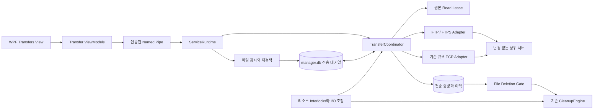
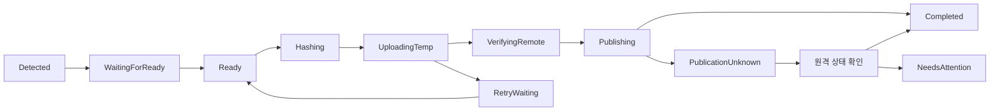

# Image Transfer — 상세 구현 설계

작성일: 2026-10-26 · 설계 버전: 1.0 · 상태: 구현 전

대상: Explorer Manager, WPF / .NET Framework 4.8 / x64 / C# 7.3 / MVVM

기준 코드: `69c08c8` · [개발 계획](../../01-plan/features/image-transfer.plan.md)

## 1. 결정 사항과 추천 구성

**상위 수신 프로그램은 수정할 수 없다. 기존 서버에 이미지를 올리는 클라이언트 기능을 만든다.** FTP를 기본 구현으로 선택하고, FTPS는 서버가 지원할 때 사용한다. TCP는 기존 상위 프로그램의 통신 명세를 확보한 경우에 해당 규격에 맞춰 추가한다. 신규 HTTP API, 서버 agent, 임의 ACK, 신규 manifest/완료 파일을 서버에 요구하지 않는다.

| 비교 | FTP / FTPS | 기존 TCP 수신기 |
|---|---|---|
| 필요한 정보 | 주소, 포트, 계정, 원격 경로, 권한, 파일명/감시 규칙 | 주소, 포트와 **실제 애플리케이션 통신 명세** |
| 파일명·경로·바이트 전송 | FTP 명령으로 표현 | 수신 규격에 따라 구현 |
| 완료 확인 | FTP 응답 + 지원되는 원격 검증 | 명세가 정의한 응답에 한함 |
| 이어 보내기 | 서버 지원과 실제 시험 결과에 따름 | 명세에 없으면 지원 불가 |
| 중복 방지 | 로컬 대기열·경로 정책·원격 조회, 불명확하면 보류 | 기존 작업 ID/조회/ACK 지원 범위에 따름 |
| 서버 수정 | 필요 없음 | 기존 규격을 따르는 한 필요 없음 |
| 이번 추천 | 먼저 완성 | 명세 확인 후 adapter로 추가 |

TCP는 바이트 스트림이다. 파일명·이미지 경계·업무 처리 확인은 별도 수신 규격이 정해야 한다. FTP도 TCP를 사용하므로 두 방식의 차이는 전송 속도 하나로 결정할 수 없다. [TCP 표준](https://www.rfc-editor.org/rfc/rfc9293.html)

이 문서의 경로·시간·용량 값은 **제안 기본값/예시**다. 사용자가 실제 경로, 서버 기능, 파일 발생량을 확정한 값이 아니다.

## 2. 사용자 동작과 성공의 의미

운영자는 `Transfers → Connections`에서 서버를 등록하고, `Transfer policies`에서 로컬 루트와 원격 경로를 연결한다. Preview로 대상 수·용량·제외 사유·삭제 보호 영향을 확인한 뒤 활성화한다. UI를 닫아도 서비스가 계속 처리한다.

예시 매핑:

```text
Local root : D:\Inspection\Camera01
Local file : D:\Inspection\Camera01\2026-10-26\LOT-A\IMG_001.jpg
Remote root: /incoming/camera01
Final path : /incoming/camera01/2026-10-26/LOT-A/IMG_001.jpg
```

기본은 원본명과 상대 폴더 구조 유지다. 기존 수신기가 한 폴더만 읽거나 고정 명명 규칙을 요구하면 그 규칙으로 설정한다. 날짜·장비명·GUID를 최종 파일명에 임의로 붙이지 않는다.

| 증빙 수준 | 확인한 사실 | 확인하지 못한 사실 |
|---|---|---|
| `BytesSent` | 클라이언트가 스트림에 바이트를 썼음 | FTP 업로드 완료, 원격 파일 내용 |
| `UploadAcknowledged` | FTP 최종 성공 응답을 받았음 | 내용 동일성, 이후 보관, 업무 처리 |
| `SizeChecked` | 성공 응답과 원격 길이가 일치 | 같은 길이의 내용 손상/교체 |
| `ContentVerified` | SHA-256으로 업로드된 내용 일치 확인 | 최종 경로 게시, 상위 업무 처리 |
| `PublishedVerified` | 내용 검증과 최종 경로 게시를 확인 | 서버의 미래 보관/백업, 상위 업무 처리 |
| `PublicationUnknown` | 게시 명령 전송 뒤 결과를 확정 못 함 | 성공/실패 모두 확정 불가 |

`PublishedVerified`는 **클라이언트가 기록한 전송 증빙**이다. 서버가 새로 발급한 영구 저장 영수증이라는 뜻이 아니다. FTP 응답만으로 서버 디스크의 전원 장애 내구성이나 상위 검사 프로그램의 처리를 보장하지 않는다. 원격 서버가 이후 파일을 삭제해도 업로드 기능만으로 자동 복구하지 않는다.

완료된 업로드를 곧바로 로컬 삭제하지 않는다. 기존 정리 엔진이 기간·용량·제외·잠금·복구·RAM 한도 조건을 적용한 시점에 삭제 여부를 판단한다.

## 3. 전체 구조와 현재 코드 연결



| 현재 코드 | 확인한 구조 | 추가/변경 |
|---|---|---|
| `ServiceRuntime.cs` | 정리·Preview·복구는 `_busy`로 직렬화 | 별도 transfer supervisor/worker, 공유 I/O 조정 |
| `CleanupEngine.cs` | 같은 검증 핸들에서 RAM 복사 후 삭제 | 전송 보호 preflight와 최종 해시 gate |
| `RecoveryCache.cs`, `RecoveryInfo.Hash` | 삭제 전 전체 SHA-256 확보 | 이 해시를 최종 비교에 재사용 |
| `Ports.cs` | 파일/캐시/실행 gate interface | 전송 저장소/transport/파일별 삭제 gate 추가 |
| `WindowsFileSystem.cs` | NTFS 경로·파일 ID·디렉터리 보호 | 업로드용 읽기 lease, 탐색 시간 제한 보완 |
| `SqliteJournal.cs` | manager.db는 WAL/FULL, `.scan`은 disposable | 전송 데이터는 manager.db에 보관, `.scan` 사용 금지 |
| `Messages.cs`, `PipeServer.cs` | IPC frame 최대 2 MiB | 목록 pagination, 설정/통계만 전달, 이미지 본문 전송 금지 |
| `MainViewModel.cs`, `MainWindow.xaml` | 기존 MVVM 화면/주기 refresh | 독립 Transfer VM/View를 조합하여 추가 |

이미지 탐색을 기존 정리 스캔 그대로 재사용하지 않는다. 정리 스캔은 보존 기간이 지난 파일을 찾지만, 전송은 새 파일부터 찾아야 한다. 경로 검증·파일 ID·볼륨 매핑 등 공통 기능만 추출한다.

현재 정리 스캔의 시간 검사는 폴더 반복문에만 있다. 단일 폴더에 파일이 많으면 제한을 넘길 수 있으므로 내부 항목 반복에도 경과 시간 검사를 추가한다. 기존 정리는 불완전 목록으로 삭제하지 않는 동작을 유지한다.

## 4. 설정 모델과 기본값

### 4.1 ConnectionProfile

| 필드 | 제안 기본값 / 규칙 |
|---|---|
| `Id`, `Version`, `Name` | GUID, 낙관적 동시성 version, 표시 이름 |
| `Transport` | Ftp / ExistingTcp |
| `Host`, `Port` | 실제 서버값, 포트 1–65535 |
| `Encryption` | ExplicitTls / ImplicitTls / Plain, 자동 downgrade 없음 |
| `CredentialRef` | 비밀번호를 제외한 비밀 저장소 참조 |
| `DataConnectionMode` | Passive, 지원 시 EPSV, 필요 시 PASV |
| `Encoding` | UTF-8 우선, 기존 서버가 요구하면 CP949 등 명시 |
| `ConnectTimeoutSeconds` | 15 |
| `CommandTimeoutSeconds` | 30 |
| `NoProgressTimeoutSeconds` | 60, 전송/검증의 실제 진행 없음 기준 |
| `MaxConnections` | 2, 서버 제한 이내 |
| `Capabilities` | 명령 지원/실제 시험 결과/확인 시각/설정 fingerprint |
| `TcpProtocolProfileId` | TCP일 때 필수, 미등록이면 사용 불가 |

FTPS 지원 시 제어 채널과 데이터 채널 모두 보호한다. Explicit FTPS는 `AUTH TLS`, `PBSZ 0`, `PROT P` 흐름을 따른다. 인증서 검증을 끄거나 FTPS 실패를 일반 FTP로 자동 전환하지 않는다. Plain FTP만 지원하는 기존 환경은 명시적으로 Plain을 선택하고 UI에 표시한다. FTPS와 SFTP는 다른 방식이며 이번 FTP adapter가 SFTP를 뜻하지 않는다. [FTPS 표준](https://www.rfc-editor.org/rfc/rfc4217.html)

### 4.2 TransferPolicy

| 필드 | 제안 기본값 / 규칙 |
|---|---|
| `Id`, `Version`, `ConnectionId` | 각 작업에 immutable revision snapshot 기록 |
| `RootId`, `VolumeId`, `LocalRoot` | 드라이브 문자만 신뢰하지 않고 NTFS 볼륨 식별 |
| `IncludeSubdirectories` | true |
| `Extensions` | `.jpg,.jpeg,.png,.bmp,.tif,.tiff`, 옵션으로 추가 |
| `ExcludedDirectories`, `ExcludedPatterns` | 상대 경로 기준, `..` 탈출 불가 |
| `RemoteRoot`, `RemotePathMode` | 실제 FTP에서 보이는 경로, PreserveRelative / Flat / Template |
| `PublishMode` | StagingThenRename 우선, 기존 수신기 호환 확인 필요 |
| `RemoteStagingRoot` | 수신기가 감시하지 않는 기존 접근 가능 위치 |
| `CollisionMode` | Hold. 최종 파일 덮어쓰기는 첫 버전에서 제공하지 않음 |
| `CompletionMode` | StableWindow 기본 제안, 기존 FinalRename/ReadyMarker 활용 가능 |
| `StableSeconds`, `ProbeIntervalSeconds` | 10초, 2초; 최초 관찰 뒤 실제 10초 이상 안정 필요 |
| `ReconcileIntervalSeconds` | 300초, 30–86400 범위 |
| `ContentAuditIntervalHours` | 변경 가능한 원본은 24시간 rolling hash audit 제안, 불변 원본 계약 시 생략 가능 |
| `InitialFilesMode` | PreviewThenBackfill / NewFilesOnly |
| `Trigger` | OnReady / Schedule / Manual, 실행 요일·HH:mm은 기존 규칙 재사용 |
| `VerificationMode` | AutoStrong: 서버 SHA-256 → 없으면 read-back SHA-256 |
| `DeletionDependency` | RequireVerifiedUpload 권장 기본값 / Independent 명시 선택 |
| `EnabledForTransfer` | false로 설치, 활성화 시 보호 규칙 먼저 반영 |
| `Priority` | 1–5, 기본 3; 같은 priority 안에서는 오래된 발견 순 |
| `MaxFileBytes` | 제안 2 GiB, 실제 이미지/서버 한도에 맞춰 조정 |

`Independent`는 전송과 기존 정리를 연결하지 않는다는 뜻이다. 대기 파일이 기존 정리 정책에 의해 사라질 수 있다는 영향을 설정 화면에 표시하고 저장 변경을 감사한다. `RequireVerifiedUpload`를 사용 중인 route를 Pause/Archive하거나 설정을 바꿨다고 기존 보호 의무를 제거하지 않는다. 보호 완화는 별도 명시적 설정 변경으로만 수행하며 영향 목록을 먼저 계산한다.

### 4.3 전역 실행 옵션

| 옵션 | 제안 기본값 |
|---|---|
| 전체 transfer worker | 2, 허용 1–8 |
| 물리 디스크당 대량 읽기 작업 | 1 |
| 업로드 총 대역폭 | 10 MiB/s, 0=무제한은 명시적 선택 |
| read-back 총 대역폭 | 10 MiB/s, 업로드와 별도 집계 |
| 공유 디스크 읽기 제한 | 디스크당 10 MiB/s부터 시작, 기존 정리별 제한도 적용 |
| 스트리밍 버퍼 | worker당 256 KiB, 전송 단계별 고정 버퍼 |
| UI 통계 refresh | 2초, 서비스 내부 progress 갱신 최대 초당 4회 |
| 메모리 이벤트 큐 | 4096 경로; 초과하면 dirty-root 재검색 |
| 최대 pending 작업 | 1,000,000; 초과 시 신규 탐색 등록 보류와 알람 |
| 연결 재시도 | full jitter, base 5초, cap 300초 |
| 서버 회로 차단 | 연속 연결 장애 5회 → 60초 후 단일 probe, 최대 15분 간격 |
| 알림 반복 간격 | 기본 300초, 상태/심각도 변경 시 별도 기록 |
| 한 번의 전송 attempt 상한 | 기본 3600초, 실제 파일 크기/회선에 맞춰 조정 |
| 상세 전송 이력 | 90일, 현재 파일 보호 증빙은 별도 유지 |

값은 출하 성능 보장이 아니다. 특히 HDD 읽기를 10 MiB/s로 제한하고 원본을 해시/송신으로 두 번 읽으면 지속적인 원본 처리량은 그보다 낮다.

## 5. 파일 탐색과 저장 완료 판단

### 5.1 감시 + 재검색

1. route 보호 규칙을 먼저 저장·게시한다.
2. watcher를 시작하고 root를 `ScanRequired`로 기록한다.
3. 초기 전체 탐색으로 대상 metadata를 upsert한다. watcher 이벤트는 가벼운 큐 입력만 수행한다.
4. 시작/5분 주기/수동 요청/버퍼 초과/볼륨 재연결/디렉터리 rename 시 재검색한다.
5. 한 번의 완전 탐색이 성공한 시점만 `LastCompleteScanUtc`로 저장한다.

감시 이벤트의 누락·중복과 폴더 이동 시 하위 파일 이벤트 누락에 대비한다. `LastWriteTime > 마지막 탐색 시각`만으로 찾으면 과거 시각이 유지된 복사 파일을 놓치므로 그렇게 구현하지 않는다. [FileSystemWatcher 문서](https://learn.microsoft.com/en-us/dotnet/api/system.io.filesystemwatcher?view=netframework-4.8)

메모리에 전체 파일 목록을 올리지 않는다. 디렉터리 iterator, 최대 256개 metadata batch, 짧은 DB transaction을 사용한다. 항목마다 취소·경과 시간·batch budget을 검사한다. 탐색이 끊기면 완료로 표시하지 않고 해당 root/디렉터리를 다시 읽어 수렴시킨다. 저장한 directory frontier도 재검색 힌트이며 불변 snapshot으로 취급하지 않는다.

watcher queue 포화는 파일을 영구 누락시키는 근거가 아니다. dirty-root를 저장하고 재검색한다. 그 저장조차 실패하면 해당 route의 탐색/증빙 상태를 Unknown으로 표시하고 삭제 보호를 유지한다.

원본이 같은 이름/크기/시각으로 바뀌면 metadata 탐색만으로는 알 수 없다. Changed 이벤트는 metadata가 같아도 내용 재검사를 예약한다. 변경 가능한 원본은 rolling hash audit도 수행하여 감시 누락 후 현재 내용에 수렴하게 한다. 재검사 전 덮어쓰여 사라진 중간 버전까지 수집하는 것은 보장하지 않는다.

NewFilesOnly를 선택해도 기존 파일이 자동 삭제 허용되는 것은 아니다. 보호 route 아래 기존 미선택 이미지에는 `NotSelectedForBackfill` 사유를 표시한다. 최초 대상 snapshot과 watcher 이벤트를 합쳐 처리하며, 단순한 생성 시각 cutoff로 신규 파일을 판단하지 않는다.

### 5.2 완료 판단 우선순위

| 모드 | 구현 | 한계/조건 |
|---|---|---|
| 기존 FinalRename | 생산기가 `.tmp` 등을 작성 후 최종 확장자로 rename하는 기존 규칙 활용 | 생산기가 최종 이름을 다시 수정하지 않는 계약 필요 |
| 기존 ReadyMarker | 이미 제공되는 완료 파일/신호의 파일 ID·크기·가능한 hash와 연결 | 임의 marker 형식을 서버/생산기에 새로 요구하지 않음 |
| StableWindow | 길이·수정 시각·파일 ID가 10초간 안정, 읽기 lease 성공 | 쓰기가 잠시 멈춘 상태를 완전 저장으로 오인할 수 있음 |

StableWindow는 보편적인 fallback이지 저장 완료의 수학적 보장이 아니다. 생산 프로그램이 긴 간격으로 append하거나 같은 이름을 계속 덮어쓰면 더 긴 안정 기간 또는 이미 존재하는 완료 신호를 사용해야 한다.

파일이 준비되면 `GENERIC_READ` + `FILE_SHARE_READ`로 연다. write/delete 공유를 허용하지 않고 볼륨/파일 ID와 경로를 재검증한다. 기존 directory guard를 재사용하여 상위 경로 교체도 검사한다. 해당 handle을 유지하는 동안 원본 해시 계산과 송신을 수행한다. 기존 writer가 있으면 기다린 뒤 재시도하며 프로세스를 종료하지 않는다. [CreateFileW 공유 규칙](https://learn.microsoft.com/en-us/windows/win32/api/fileapi/nf-fileapi-createfilew)

네트워크 장기 대기 중에는 lease를 놓는다. 재개 때 다시 열어 동일 원본인지 검증한다. 파일이 잠시 읽기 전용으로 잠기는 영향은 실제 생산 프로그램과 시험한다. 저속 업로드 동안 생산기가 같은 이름을 재사용하는 환경은 직접 스트리밍과 충돌할 수 있다. 별도 디스크 spool은 이 문제의 선택적 확장이며 첫 구현에서 몰래 추가하지 않는다.

원본은 이미지 bytes 그대로 보내며 디코딩·압축·회전·EXIF 수정하지 않는다. 확장자와 가벼운 signature 검사만 하며 TIFF 대형 파일 등을 WPF Bitmap으로 전부 로드하지 않는다. 링크/junction/ADS/다중 hard link 등 기존 미지원 특수 항목은 그대로 스킵하고 보호 사유를 남긴다.

## 6. 원본 ID와 경로 규칙

`SourceVersionId`는 전송할 로컬 파일 세대의 GUID다. 다음을 함께 기록한다.

```text
RootId + VolumeId + FileId + 정규화된 LocalPath
Length + CreationUtc + LastWriteUtc + SourceVersionId + SHA256
```

경로·크기·시각은 빠른 변경 탐지에 사용하고 동일 본문의 최종 증명으로 사용하지 않는다. 같은 길이와 시각으로 교체해도 삭제 직전 해시가 다르면 보호된다. 파일 ID 재사용도 기존 시각·경로·hash를 함께 검증하고 불명확하면 새 세대로 처리한다.

rename/다른 경로 이동/덮어쓰기/복구로 원본 세대가 달라지면 기존 전송 이력을 보존하고 새 작업을 만든다. v1은 rename 시 원격 경로 metadata만 수정하는 최적화를 하지 않는다. 이전 버전과 새 버전의 원격 최종 경로가 같으면 자동 덮어쓰기 대신 Conflict로 보류한다.

route 간 원본 root 중첩과 같은 물리 경로의 alias 중복을 검증한다. v1에서는 한 파일에 여러 전송 의무를 중첩하지 않는다. 원격 경로는 POSIX 형태의 segment로 구성하고 로컬 `Path.Combine` 결과를 그대로 사용하지 않는다. 절대 경로 삽입·`..`·CR/LF/NUL·인코딩 불가능 문자·길이 초과를 거절한다. 대소문자/Unicode 처리와 한글 파일명은 실제 서버의 규칙으로 검증한다.

## 7. 작업 상태와 durable queue



| 상태 | 처리 |
|---|---|
| Detected / WaitingForReady | 안정화 전, 삭제 보호 |
| Ready / Hashing | 작업 claim, 원본 고정과 hash 준비 |
| UploadingTemp | 임시 경로 전송, 진행률은 성공 증빙이 아님 |
| VerifyingRemote | 서버 hash 또는 read-back으로 내용 확인 |
| Publishing | **게시 intent를 DB에 저장한 뒤** rename 또는 기존 규격의 게시 명령 |
| Completed | 최소 FTP 게시 성공, `EvidenceLevel`로 검증 수준 구분 |
| RetryWaiting | 일시 오류, NextAttemptUtc까지 대기 |
| PublicationUnknown | 결과를 다시 조회할 수 있을 때 확인, blind retry 금지 |
| NeedsAttention | 인증/권한/충돌/지원 부족/불명확 결과 등 사람의 설정 수정 필요 |
| SourceMissing / Superseded | 원본 소실/변경, 원인 기록 및 새 세대 등록 |
| Cancelled | 새 전송 중단; 보호 자동 해제 아님 |

Pause는 route/전체 실행 플래그로 두어 원래 작업 단계를 잃지 않는다. `Completed`와 `EvidenceLevel`은 별개다. `Completed + SizeChecked`를 강한 검증 완료로 표시하거나 삭제 gate를 통과시키지 않는다.

claim은 짧은 SQLite transaction으로 하나의 due job을 선택하고 `(StateVersion, LeaseToken, BootEpoch)`를 갱신한다. worker는 그 token이 유지될 때만 상태를 저장한다. 서비스 시작 시 이전 BootEpoch의 실행 중 항목은 원격 reconcile 대상으로 바꾼다. UI 요청의 idempotency ID와 파일 전송 ID는 서로 다른 목적이다.

재시도는 같은 작업의 소유한 임시 경로를 사용한다. source hash나 목적지 식별이 달라졌다면 같은 ID의 의미를 바꾸지 않고 새 작업을 만든다. UTC는 기록용, 대기·timeout은 monotonic clock을 사용한다. 큰 시스템 시각 변경 시 실행 중 lease를 무조건 재배정하지 않고 재조정한다.

설정 revision 중 **전송 내용/목적지에 영향을 주는 변경**과 실행 옵션 변경을 구분한다. DestinationFingerprint는 protocol, 논리적 connection target, host/port, 계정 identity, 원격 경로 규칙/인코딩을 포함한다. 비밀번호 교체, 속도, priority, schedule 변경은 fingerprint에서 제외한다. 이 변경만으로 완료 이미지를 다시 전송하지 않는다. job에는 최초 descriptor와 각 attempt의 실행 revision을 기록한다. 검증 기준을 높이면 기존 증빙의 충분함을 다시 평가하되 새 검증만으로 충족할 수 있으면 본문 재업로드를 생략한다.

## 8. FTP / FTPS 구현 상세

### 8.1 라이브러리와 연결 수명

`FluentFTP`를 후보로 사용한다. 구현 시 Framework 4.8에서 빌드되는 안정 버전을 고정하고 실제 adapter 시험을 통과시킨다. 패키지 버전을 이 설계만으로 최신이라고 단정하지 않는다. 프레임워크를 .NET 8로 올리지 않는다. FTP를 직접 문자열 파서부터 구현하는 범위를 줄이고 기존 라이브러리의 서버 호환 기능을 활용한다. [FluentFTP 공식 저장소](https://github.com/robinrodricks/FluentFTP)

- worker당 한 FTP session을 사용한다. 한 session에 여러 작업의 명령을 동시에 보내지 않는다.
- 연결은 연속 작업에 재사용하고 인증/목적지/인코딩 변경 시 교체한다.
- lease에서 얻은 `Stream`을 전송 API에 넘긴다. 라이브러리가 파일 경로를 다시 열어 다른 내용을 보내지 않도록 한다.
- 전체 파일 `byte[]`를 만들지 않는다. high-level API를 쓰더라도 resume·재시도·검증·overwrite 부작용을 adapter 시험으로 확인한다.
- 라이브러리 내부 자동 재시도와 coordinator 재시도를 중첩하지 않는다. 원격 mutation의 정책은 coordinator가 소유한다.
- 취소/timeout 시 관련 data/control connection을 정리하고 다음 작업은 새 session으로 시작한다. 뒤늦은 FTP reply가 다음 명령의 reply로 처리되지 않게 한다.
- 명령 timeout과 데이터 무진행 timeout을 분리한다. 매우 큰 파일이 정상 진행 중인데 30초 전체 timeout으로 끊기지 않게 한다.

### 8.2 서버 capability 확인

`Test connection`은 로그인/목록/명령 지원 조회를 수행한다. 실제 쓰기 권한이나 업로드 resume는 선언만으로 확정하지 않는다. 별도 `Test upload`에서 사용자가 지정한 시험 경로에 작은 파일을 올려 검증·rename·정리를 시험한다. 운영 이미지 경로에 임의 probe 파일을 만들지 않는다.

| 기능 | 확인 방법 | 없을 때 |
|---|---|---|
| 파일 목록/크기 | MLST/MLSD 또는 서버별 LIST/SIZE | 확인 불가로 표시, missing으로 간주하지 않음 |
| 서버 SHA-256 | FEAT 및 실제 hash 명령 시험 | RETR read-back 검증 |
| RETR 권한 | 시험 파일 다운로드 hash | 강한 검증 불가 표시 |
| 업로드 resume | REST와 STOR 조합의 실제 시험 | 본인 임시 파일을 처음부터 다시 전송 |
| rename | 시험 위치에서 RNFR/RNTO 및 소비 동작 확인 | 기존 수신기의 DirectWrite 규칙 확인 |
| 하위 폴더 생성 | MKD 권한 확인 | 기존 폴더만 사용, 경로 오류 보류 |
| TLS/passive/인코딩 | 데이터 채널 포함 실제 접속/파일명 시험 | 명시적 설정 수정, 자동 보안 downgrade 없음 |

SIZE/MLST/REST는 서버 지원 범위에 따라 사용한다. `550` 하나만 보고 파일이 없다고 판단하지 않는다. 권한 거부도 같은 종류의 실패로 보일 수 있다. 정보가 모호하면 RemoteStateUnknown이다. [FTP 확장 표준](https://www.rfc-editor.org/rfc/rfc3659.html)

SHA-256 지원을 MD5/CRC 등과 혼동하지 않는다. 서버가 제공하는 hash 알고리즘이 약하거나 없으면 read-back으로 SHA-256을 계산한다. 둘 다 불가능하면 `SizeChecked` 또는 `UploadAcknowledged`까지만 기록한다.

### 8.3 정상 전송 순서

```text
1. due job claim → 원본 Read Lease → 원본 전체 SHA-256 계산
2. immutable descriptor / 최종 경로 / 임시 경로 / source hash를 DB에 저장
3. 연결·로그인·TYPE I·passive 데이터 연결 준비
4. 최종 경로 충돌 확인, 임시 경로의 기존 상태 확인
5. STOR 또는 검증된 REST+STOR → 스트리밍 → 최종 transfer reply 확인
6. 원격 임시 파일의 크기와 SHA-256 검증
7. Publishing intent를 DB에 durable 기록
8. 최종 경로 충돌 재확인 → RNFR 임시 경로 → RNTO 최종 경로
9. 성공 응답 확인 → Evidence + Completed + audit를 같은 DB transaction으로 저장
10. 진행 통계 반영, lease/연결 자원 정리
```

`125/150` 같은 시작 응답을 성공으로 저장하지 않는다. 데이터 전송 종료 후 최종 응답을 확인한다. rename의 성공은 업로드 종료 응답과 별도로 확인한다. [FTP 표준](https://www.rfc-editor.org/rfc/rfc959.html)

원본 handle은 hash와 본문 송신 동안 유지한다. 본문 전송 및 FTP 종료 응답 이후 서버 hash/read-back/rename만 남았다면 놓을 수 있다. 이후 원본이 바뀌어도 과거 증빙을 새 내용의 완료로 간주하지 않는다.

hash 계산 후 원본 stream을 처음 위치로 되돌려 송신한다. resume일 때만 검증된 offset으로 이동한다. snapshot 길이와 실제 송신 bytes가 다르면 완료 처리하지 않는다.

### 8.4 임시 파일과 게시 방식

최종 이름을 기존 수신 규칙에 맞추고, 임시 이름만 클라이언트가 소유한 고유 이름으로 만든다.

```text
Temp : /staging/em-client01/<TransferId>/<AttemptId>.part
Final: /incoming/camera01/2026-10-26/LOT-A/IMG_001.jpg
```

위 staging은 예시다. **상위 프로그램이 해당 위치를 감시하지 않아야 한다.** `.part` 확장자면 반드시 무시한다고 가정하지 않는다.

| 기존 수신 동작 | PublishMode |
|---|---|
| 감시 밖 staging에서 final로 rename 가능 | StagingThenRename 권장 |
| 같은 폴더에서 특정 임시 확장자를 무시 | 그 기존 확장자 규칙으로 SameDirectoryRename |
| 기존 규격이 close/size 안정 후 읽는 DirectWrite | 기존 규격에 맞춘 DirectWrite, 제약 명시 |
| 생성 즉시 읽고 임시 이름도 무시하지 않음 | 안전한 게시 방법 미확정. 임의 구현 대신 호환성 미충족 표시 |

FTP rename이 모든 서버·모든 파일시스템 경계에서 atomic이라고 보장하지 않는다. 실제 staging/final 위치에서 rename 동작을 검증한다. DirectWrite는 수신기가 부분 파일을 읽지 않는 기존 계약이 확인된 경우에만 활성화한다.

DirectWrite에서는 최종 이름이 처음 노출되기 전 `Publishing` intent를 저장한다. 중간 네트워크 단절도 수신기가 이미 관측했을 가능성이 있으므로 일반 temp 실패보다 엄격하게 reconcile한다. 검증할 final 파일이 즉시 소비되어 사라졌으면 강한 검증 성공을 추정하지 않는다.

기존 프로토콜에 없는 `.done`, JSON manifest, checksum sidecar를 추가하지 않는다. 필요하다면 기존 수신 명세에서 실제로 요구하는 경우에만 명시적으로 지원한다.

### 8.5 이어 보내기

1. 같은 job 소유의 임시 경로만 대상으로 한다. 단순히 같은 이름의 파일이라고 resume하지 않는다.
2. 원본을 다시 열어 전체 hash가 기존 descriptor와 같은지 확인한다.
3. 원격 크기 `r`을 조회한다. `r < 0`, `r > 원본 길이`, 상태 Unknown이면 resume하지 않는다.
4. 원격 prefix 내용과 로컬 첫 `r` bytes를 hash로 비교할 수 있을 때만 검증된 resume로 분류한다. 원격 임시 파일 전체가 prefix이므로 RETR로 읽어 비교할 수 있다.
5. 서버가 실제 upload restart를 지원하면 `REST r` 후 `STOR`, 로컬 stream position=`r`로 전송한다.
6. 최종 전체 hash 검증을 다시 수행한다. offset만 맞는 것은 검증이 아니다.

resume가 불가하면 본인 소유 임시 파일을 정책에 따라 재시작한다. 원격 최종 파일이나 다른 작업의 파일을 지우지 않는다. 임시 파일 정리 권한이 없으면 새 attempt 경로를 만들되 누적 orphan 수/용량을 제한하고 알람을 남긴다. 디스크 spool이나 RAM 전체 복사로 우회하지 않는다.

### 8.6 원격 검증

- **Server SHA-256**: 같은 임시 경로에 대한 hash 결과의 알고리즘과 길이를 확인하고 로컬 SHA-256과 비교한다.
- **Read-back SHA-256**: RETR 결과를 고정 버퍼로 해시한다. 로컬 디스크에 파일을 만들지 않고 정확한 byte 수와 EOF를 확인한다.
- **SizeOnly**: 크기와 최종 성공 응답만 확인한다. UI에 `Uploaded · size checked`로 표시하며 기본 삭제 gate는 통과하지 않는다.
- **검증 실패**: 최종 게시하지 않고 HashMismatch로 보류한다. 본인 임시 파일에 한해 최대 3회의 재전송 후 NeedsAttention으로 올린다.

읽기 검증에는 추가 네트워크 download가 발생한다. 속도 제한, 통계, ETA에 포함한다. 업로드 진행률 100% 이후 `Verifying` 상태가 계속될 수 있으며 이것을 멈춤으로 표시하지 않는다.

### 8.7 경로 충돌과 중복

기본은 최종 파일을 덮어쓰지 않는 것이다. 기존 final이 있으면 자체 완료 증빙과 원격 동일성까지 확인 가능한 경우에만 AlreadyPresent로 reconcile한다. 같은 크기/이름만 같으면 Conflict다.

FTP의 존재 확인 후 rename은 atomic한 create-if-absent가 아니다. 다른 작성자가 그 사이 파일을 만들 수 있다. 따라서 v1의 강한 충돌 회피는 **장비별 전용 destination 또는 기존 규칙상 유일한 파일명**을 전제로 한다. 여러 작성자가 같은 최종 이름을 사용할 수 있는 환경에서는 단순 사전 조회만으로 무덮어쓰기를 보장하지 않는다. 서버의 overwrite 거절 동작도 실제 시험한다.

최종 이름에 suffix를 붙이는 옵션은 수신기와 호환되는 경우에만 후속 추가한다. 업로드 성공률을 높이기 위해 이미지 이름을 자동 변경하지 않는다.

### 8.8 완료 응답 유실과 재시작

| 재시작 당시 상태 | 복구 방법 |
|---|---|
| temp 업로드 중 | 원본/소유 temp 검사 후 resume 또는 처음부터 전송 |
| temp 전송 완료, 검증 전 | temp hash 확인 후 검증 계속 |
| 검증 완료, 게시 intent 없음 | 같은 temp/descriptor 확인 후 intent 생성 |
| 게시 intent 있음, RNTO 응답 없음 | final/temp를 조회해 게시 결과 reconcile |
| final이 존재하고 강한 동일성 확인 가능 | 증빙 보완 후 Completed |
| final/temp 모두 없음, 수신기가 즉시 소비할 수 있음 | PublicationUnknown 유지, 자동 재업로드/삭제 금지 |
| final 내용이 다름 | Conflict, 기존 원격 파일 유지 |
| 원격 조회 권한 없음 | Unknown 유지, 존재/부재를 추측하지 않음 |
| RNTO 성공을 DB에 저장하기 전 로컬 DB 실패 | intent를 근거로 다음 시작 시 reconcile, 강한 증빙 없으면 보호 |

FTP만으로 이미 소비된 파일의 업무 중복을 일반적으로 판별할 수 없다. **모든 장애에서 exactly-once 처리**를 주장하지 않는다. 자동 복구가 확실한 경우만 진행하고, 확인 불가 상태는 UI에서 별도 처리한다. 운영자가 재전송을 선택하면 중복 처리 가능성을 설명하고 새 AttemptId 및 결정 사유를 감사한다. 이를 상위 업무 처리 완료로 기록하지 않는다.

## 9. TCP adapter의 구체적인 경계

상위 TCP 명세가 없으므로 새 패킷 형식을 발명하지 않는다. 설정의 TCP 선택은 `Protocol profile required` 상태로 두고 실제 profile이 등록되어야 실행한다.

| 반드시 확인할 항목 | 구현에 미치는 영향 |
|---|---|
| client/server 역할, 주소/포트, 연결 유지 방식 | TcpClient 수명과 동시 연결 제한 |
| 헤더 길이/바이트 순서/길이 단위 | framing parser와 최대 길이 검증 |
| 파일명·경로·문자 인코딩 | metadata serializer와 한글 처리 |
| 원본 binary/base64/기타 방식 | 스트리밍 encoder와 실제 전송량 |
| 여러 파일 구분, 종료 조건 | 한 파일/한 연결 또는 프레임 연속 전송 |
| ACK/NAK의 의미와 correlation 값 | 전송 증빙 수준과 결과 불명 판단 |
| checksum/상태 조회/중복 키 | 재개·검증·중복 방지 가능 범위 |
| heartbeat/timeout/TLS | 기존 수신기의 규칙에 맞춘 연결 관리 |

소켓 read 한 번이 메시지 한 개라는 가정을 하지 않는다. partial/coalesced read, EOF, 잘못된 길이, 최대 frame 제한을 처리한다. 기존 규격이 length 기반이면 `ReadExactly` 반복을 구현하고, delimiter 기반이면 binary 이미지에서 delimiter escape 규칙까지 따른다.

TCP write 완료와 TCP ACK는 상위 프로그램의 파일 저장 확인이 아니다. 애플리케이션 ACK/조회가 없으면 `BytesSent` 이상을 추정하지 않는다. 명세에 resume가 없으면 임의 offset부터 보내지 않는다.

.NET Framework 4.8의 실제 API를 사용한다. 최신 .NET의 CancellationToken overload를 가정하지 않는다. 취소되지 않는 connect/read/TLS 단계는 timeout 시 해당 socket/stream을 dispose하고 남은 task의 종료를 관찰한다. 서로 다른 retry가 같은 socket을 공유하지 않는다.

## 10. 데이터 모델과 transaction

전송 이미지 본문은 DB에 넣지 않는다. 설정/작업/증빙은 기존 `manager.db`에 넣어 삭제 gate와 일관되게 조회한다. 별도 DB를 사용하여 증빙 commit과 삭제 intent 사이에 분산 transaction 문제를 만들지 않는다.

| 테이블 | 핵심 필드 |
|---|---|
| `transfer_connections` | id, version, protocol, public_config_json, credential_ref, capability_json, checked_utc |
| `transfer_policies` | id, version, root/volume/local_path, connection_id, mode, enabled, settings_json |
| `transfer_policy_revisions` | policy_id, version, immutable descriptor, created_utc, actor |
| `transfer_guards` | guard_id, policy_revision, root/path/filter, dependency_mode, active/retired, created_utc |
| `transfer_sources` | source_version_id, root_id, volume_id, file_id, path_key/path, length, times, sha256, is_current, first_seen, last_seen, scan_epoch |
| `transfer_jobs` | transfer_id, source_version_id, policy_revision, destination_fingerprint, remote_temp/final, state, evidence_level, attempts, next_attempt, state_version, lease_token, boot_epoch, last_error |
| `transfer_attempts` | attempt_id, transfer_id, stage, started/ended, bytes_sent/read_back, response_code, error_code, duration, actor |
| `transfer_evidence` | evidence_id, transfer_id, source identity, source_sha256, length, destination revision/path, verification_method/hash, upload_reply, publish_reply, verified/published_utc |
| `transfer_scans` | root_id, scan_epoch, state, last_complete, dirty_reason, counters |

비밀번호는 public_config_json과 분리하여 서비스의 비밀 저장소에서 관리한다.

주요 제약/인덱스:

```text
UNIQUE(source_version_id, destination_fingerprint)
UNIQUE(root_id, path_key) WHERE is_current = 1
transfer_jobs(state, next_attempt_utc, priority, first_seen_utc, transfer_id)
transfer_jobs(policy_id, state, updated_utc, transfer_id)
transfer_sources(root_id, path_key)
transfer_sources(volume_id, file_id)
transfer_evidence(source_version_id, destination_fingerprint, source_sha256)
transfer_attempts(transfer_id, started_utc)
```

동일 경로의 current source 조회/생성/세대 교체와 job 등록은 한 transaction으로 수행한다. watcher와 scanner가 동시에 새 GUID를 만들어 중복 작업을 만들지 못하게 한다. 이전 세대는 is_current=false로 보존한다. 같은 metadata의 내용 변경은 hash audit가 새 세대로 전환한다.

두 worker의 중복 claim은 상태 version 조건부 update로 막는다. 네트워크/파일 hash/대량 탐색을 DB transaction이나 `_commands` lock 안에서 수행하지 않는다. 상태 전이·게시 intent·완료 증빙은 durable commit하고, 화면용 bytes progress는 메모리 집계와 제한된 checkpoint를 사용한다.

`SqliteJournal`의 DB 소유권과 transaction helper를 명확하게 추출하여 `SqliteTransferStore`가 같은 owner를 통해 접근하게 한다. 현재 SQL 문자열에 `candidates` 포함 여부로 `.scan` 연결을 고르는 구현에 전송 테이블을 억지로 끼워 넣지 않는다. 연결 선택을 명시적으로 구분하고 한 writer 경로를 유지한다.

WAL, `synchronous=FULL`, busy timeout을 유지한다. WAL이 있어도 동시에 여러 writer가 무제한으로 쓰는 구조가 되지는 않는다. UI 조회를 짧게 유지하고 progress를 packet마다 기록하지 않는다. [SQLite WAL 문서](https://www.sqlite.org/wal.html)

### 보존과 크기 제한

- 일반 attempts/통계는 설정된 기간 뒤 정리할 수 있다.
- 미완료 job, PublicationUnknown, 현재 로컬 파일의 삭제 판단에 필요한 evidence/guard는 일반 HistoryDays로 지우지 않는다.
- 원본의 실제 부재를 완전 재검색으로 확인하고 삭제/복구 참조가 없을 때만 증빙을 grace period 이후 축약한다.
- queue 상한/metadata 용량 경고 시 신규 발견 등록을 보류할 수 있지만 보호 판정은 root 규칙으로 계속 수행한다.
- 공간 측정에는 DB와 WAL을 포함한다. 보호 row 때문에 한도를 맞출 수 없으면 알람을 남긴다.
- DB 오류/부재를 빈 대기열로 취급하지 않는다. 기존 서비스의 감사 불가 동작과 연동하여 삭제를 차단한다.

## 11. 삭제 엔진과의 결합

### 11.1 대기열 등록 이전부터 보호

삭제 보호는 `업로드 중 job이 있는가`만 확인하면 안 된다. watcher가 놓쳤거나 초기 스캔 전인 파일도 보호해야 한다.

```text
전송 의무 = 현재 파일이 활성/보존된 TransferGuard의 경로·파일 조건에 해당

삭제 허용 = 기존 삭제 조건 충족
          AND (전송 의무 없음 OR 현재 파일에 맞는 충분한 전송 증빙 있음)
```

필터로 새 전송 대상에서 제외했다고 이미 등록된 미완료 의무까지 지우지 않는다. 활성화는 guard 저장/게시 후 탐색 시작 순서다. Pause는 worker만 멈추며 guard는 남는다. route 삭제는 Archive로 수행하고 미완료 의무와 보호 규칙을 유지한다. 경로/서버 변경은 새 destination revision으로 만들며 과거 목적지의 성공이 새 목적지 성공을 대신하지 않는다. 일반 실행 설정 version만 달라진 경우에는 같은 destination의 충분한 증빙을 인정한다.

### 11.2 두 단계 gate

**Preflight:** RAM 복사 전에 대상 범위와 증빙 존재 여부, 현재 upload lease를 확인한다. 불충분하면 `AwaitingUpload`, `TransferBusy`, `VerificationUnavailable`, `PublicationUnknown` 등의 이유로 스킵한다. 내부 uploader 잠금을 사용자 프로세스 강제 종료 알람으로 잘못 올리지 않는다.

**Final gate:** 기존 `OpenVerified` handle을 유지하고 RAM capture가 제공한 `RecoveryInfo.Hash`를 전송 증빙과 비교한다. source volume/file ID/path/길이/hash, destination revision, EvidenceLevel을 모두 확인한다. 일치하지 않으면 임시 RAM capture를 취소하고 원본을 유지하며 재검색을 예약한다.

```csharp
// 설계용 의사 코드. 실제 interface/오류 타입은 구현 시 확정한다.
var file = files.OpenVerified(expected, policy);
try {
    var preflight = deletionGate.CheckMetadata(file.Snapshot);
    if (!preflight.Allowed) return Skip(preflight.Reason);
    var cached = await cache.CaptureAsync(/* 기존 복사·hash·속도 제한 */);

    // 아래는 await 없는 짧은 구간. 정책 게시와 삭제 확정을 직렬화한다.
    using (var permit = deletionGate.AcquireCommitPermit()) {
        var decision = deletionGate.CheckCurrentContent(file.Snapshot, cached.Hash);
        if (!decision.Allowed) { cache.Remove(cached.Id, decision.Reason); return Skip(decision.Reason); }
        journal.RecordDeleteIntentWithEvidence(/* item + evidence IDs + guard revision */);
        file.MarkForDeletion();
        file.Dispose(); // 삭제 handle의 close까지 commit permit 안에서 수행
        file = null;
    }
}
finally { if (file != null) file.Dispose(); }
```

실제 구현은 의사 코드의 return 흐름을 현재 Run loop에 맞춰 적용한다. 기존 취소/Interlock/보존 기간/목표 용량 검사도 삭제 직전에 유지한다. `DeleteIntent`에 `TransferEvidenceIds`, `GuardRevision`, `VerifiedSourceHash`를 함께 남긴다.

정책 변경과 삭제 확정 사이에 race가 생기지 않게 한다. guard 활성화/변경은 write barrier, 최종 gate→intent→disposition→handle close는 read/commit permit으로 조정한다. hash/network await 중에는 permit을 잡지 않는다. lock 순서는 policy barrier → 짧은 DB transaction이며 반대로 진입하지 않는다. 활성 item은 새 guard 반영 전 안전 지점에서 중단/재검사한다.

### 11.3 기존 동작 유지

- 전송 완료만으로 보존 기간이 줄어들지 않는다.
- 미전송 파일이 남은 폴더는 그대로 남는다. 현재 폴더 완료란 삭제 가능한 항목을 마쳤다는 뜻이다.
- RAM 캐시보다 큰 파일은 업로드할 수 있어도 기존 정리에서는 CacheTooSmall로 스킵한다.
- 잠금 프로세스를 강제 종료한 뒤 Retry하더라도 전송 gate를 다시 적용한다.
- Restore의 보호 기간은 유지한다. 복구로 생긴 새 파일 ID를 과거 파일의 업로드 완료로 자동 인정하지 않는다.
- Preview는 동일한 보호 이유를 표시한다. hash를 실제로 확인하지 않은 항목은 `EligiblePendingFinalVerification`으로 구분한다.
- 서버 연결 장애만으로 모든 정리를 정지하지 않는다. 이전 증빙이 충분한 파일과 전송 의무가 없는 파일은 기존 조건에 따라 정리할 수 있다.

전송 증빙은 과거에 업로드/게시한 사실이다. **삭제 시점에도 서버에 장기 보관되어 있다는 보장**까지 필요하면 기존 서버의 보관/조회 계약이 추가로 필요하다. 이 기능을 원격 백업 보장으로 표현하지 않는다.

## 12. 실행 조정과 Interlock 우선순위

전송 worker를 기존 `StartOperation`의 `_busy` 안에 넣으면 대용량 업로드 한 건이 모든 정리·복구를 오래 막는다. 별도 supervisor와 CancellationTokenSource를 두고 파일/디스크 접근만 조정한다. 기존 cleanup/preview/restore의 직렬화는 우선 유지한다.

| 조건 | 정리 | 이미지 전송 |
|---|---|---|
| 서비스 종료/전체 긴급 중지 | 기존 안전 지점 중단 | 연결/읽기 취소, 상태 저장, source lease 해제 |
| Audit/DB 불가 | 차단 | 새 mutation/게시 중단, 불명확 단계 reconcile |
| RAM 부족 | 기존 차단 | 신규 읽기·hash 중단, 고정 버퍼 회수 |
| CPU/온도/활성 디스크 지연 trip | 기존 차단 | 해당 resource scope의 대량 읽기 중단 |
| 원본 디스크 Critical | 해당 볼륨 차단 | 해당 볼륨 전송 중단 |
| 측정 누락 | 기존 latch 규칙 | 이미 trip한 채널을 정상으로 간주하지 않음 |
| 지정 프로세스 실행 | 기존 cleanup 차단 | 기본 영향 없음; 별도 transfer blocker 선택 시 적용 |
| FTP 인증 실패/서버 연결 불가 | 파일별 증빙 gate만 적용 | 해당 connection의 새 작업 차단/backoff |
| 원격 용량 부족 | 미전송 대상 보호 | 해당 connection 보류 및 알람 |
| 대기열 포화/탐색 불완전 | guard는 유지 | 기존 job drain, 신규 등록 보류/재검색 |
| 수동 Pause cleanup | 정리만 중단 | 계속 가능 |
| 수동 Pause transfers | 영향 없음, 미전송 보호 유지 | 새 파일 시작 중단 |

기존 프로세스 Interlock을 그대로 전송에 걸면 생산 프로그램이 실행되는 동안 업로드도 멈추는 교착 운영이 생길 수 있다. `Cleanup`, `Transfer`, `Both` scope를 명확히 구분한다. Reset은 FTP 인증/권한/증빙 조건을 우회하지 않는다.

### 디스크와 작업 공정성

- 볼륨 문자가 달라도 같은 물리 HDD이면 하나의 I/O lane으로 묶는다. 매핑이 불명확하면 보수적으로 대량 읽기를 직렬화한다.
- source 읽기/hash와 cleanup RAM capture가 같은 lane을 동시에 과도하게 사용하지 않게 조정한다.
- 첫 구현은 같은 디스크의 진행 중 파일이 끝나거나 취소되는 경계에서 양보한다. 다른 디스크는 전역 worker/회선 제한 안에서 진행한다.
- 복구 요청은 우선권을 가진다. 필요하면 uploader의 현재 전송을 안전하게 취소하고 owned temp를 다음에 reconcile한다.
- route 사이 weighted round-robin + 오래 기다린 작업 우선으로 starvation을 막는다. 신규 파일만 계속 우선하여 오래된 backlog를 굶기지 않는다.
- 로컬 용량 압박은 그 디스크 backlog의 priority를 올릴 수 있지만 미검증 삭제, 속도 제한 해제, 건강 Interlock 우회의 근거가 되지 않는다.
- limiter는 디스크 읽기/업로드/read-back을 구분한다. 기존 개별 정리 제한과 공유 제한을 동시에 만족시키되 중복 sleep으로 속도가 불필요하게 절반이 되지 않게 한다.

### 중단 동작

`Pause after current file`은 신규 파일 시작을 막고 현재 업로드·검증·게시를 마친다. `Stop now`는 현재 I/O를 취소하고 재개 가능한 단계로 기록한다. 리소스 위험/서비스 종료/설정의 중요한 변경은 즉시 취소 경로를 쓴다. 느린 정상 연결도 attempt 상한을 넘으면 중단한다.

설정 변경은 immutable revision으로 처리한다. host/원격 경로/인코딩/파일명 규칙 변경 때 기존 job을 새 서버로 조용히 돌리지 않는다. 이전 job은 이전 목적지에 고정하고, 운영자가 새 대상으로 옮기기를 선택하면 새 job 및 이력을 만든다. 진행 중 publication은 변경 결과와 무관하게 먼저 reconcile한다.

## 13. 오류·재시도·알림

| 오류 | 자동 처리 |
|---|---|
| DNS/connect/data timeout, 일시 연결 reset | jitter backoff, server breaker |
| FTP 421/425/426, 일시 450/451 | 단계별 remote reconcile 후 재시도 |
| 452/552 등 원격 공간/할당량 부족 | DestinationFull, 긴 probe 간격과 알람 |
| 530 로그인 실패 | Connection AuthBlocked, 설정 수정까지 개별 파일 retry 폭주 방지 |
| 경로/쓰기/rename 권한, 잘못된 이름 | route NeedsAttention, 원본 유지 |
| 550 조회 실패 | 부재/권한 거부를 구별할 근거 없으면 Unknown |
| TLS 인증서 오류 | 차단, 인증서 검사 해제나 Plain fallback 없음 |
| checksum 불일치 | 소유 temp만 재처리, 3회 뒤 NeedsAttention |
| source 잠김 | 안정화 대기, 30분 지속 시 집계 알람; 자동 프로세스 종료 없음 |
| source 변경 | 이전 세대 Superseded, 새 내용 발견 등록 |
| final 경로 충돌 | Conflict, overwrite 없음 |
| publish 응답 유실 | PublicationUnknown, §8.8 reconcile |
| DB 쓰기 실패 | 파일 삭제/신규 원격 게시 중단, 기존 intent 보존 |

연결 장애는 endpoint 기준 한 알람으로 집계한다. 예: `Camera01 FTP offline · 1,250 files / 4.8 GiB pending`. 파일마다 popup을 띄우지 않는다. 원인별 첫 발생·회복·심각도 상승을 기록하고 반복 통지는 interval을 적용한다.

기존 LockedFile 알람과 전송의 WaitingForReady/TransferBusy 알람을 분리한다. 전송 대기 때문에 생산 프로그램을 강제 종료시키는 버튼을 제공하지 않는다. 정리의 강제 종료 흐름은 기존 권한/동의 규칙을 유지하되 최종 전송 gate를 통과해야 한다.

원격 응답 문자열은 길이를 제한하고 비밀번호/계정 secret/세션 토큰을 제거한다. 에러 code와 사람이 읽을 설명을 분리하여 테스트와 UI 필터가 번역 문장에 의존하지 않게 한다.

## 14. WPF 화면과 MVVM 계약

좌측 메뉴에 `Transfers`를 추가하고 기존 색/간격/타이포그래피를 따른다.

```text
Transfers                    Running    8.2 MiB/s    Pause    Stop now

Queued 1,250   Uploading 2   Uploaded today 8,921   Attention 3
Pending 4.8 GiB              Oldest wait 00:18:22  Protected 4.8 GiB

Connection [All]   Policy [All]   State [All]   Search [__________]

File / relative path | Destination | Stage | Progress | Verification | Retry
IMG_001.jpg          | Camera01    | Uploading | 64% | Pending       | 0
IMG_002.tif          | Camera01    | Verifying | 100% sent | Read-back | 0
IMG_003.jpg          | Camera02    | Unknown | — | Needs review    | 2

선택 상세: 원본/최종 경로, 크기, 작업 ID, 각 단계 시각,
FTP 응답, 검증 방법/hash, 시도 이력, 정리 보호 사유
```

화면 구성:

| 영역 | 내용 |
|---|---|
| Overview | 연결 상태, 현재 속도, pending 수/bytes, 가장 오래된 대기, 문제 수 |
| Queue / History | 상태·기간·정책·연결별 필터, 100개 단위 keyset pagination |
| Policies | 로컬/원격 경로, 형식, 안정화, schedule, 검증, 삭제 연동 |
| Connections | host/port/암호화/계정 참조, 읽기 전용 Test connection, Test upload |
| Detail | state transition, remote evidence, attempt 오류, 보호 이유 |

명령: `SaveTransferPolicy`, `SaveConnection`, `SetConnectionSecret`, `PreviewTransfers`, `StartBackfill`, `PauseTransfers`, `ResumeTransfers`, `StopTransfersNow`, `RetryTransfer`, `ReconcileTransfer`, `ArchiveTransferPolicy`.

조회: `GetTransferSummary`, `GetTransferJobs(cursor,filters,limit)`, `GetTransferDetail`, `GetTransferConnections`, `GetTransferPolicies`. 2 MiB pipe 한도 안에서 DTO를 제한하고 서버에서 limit/경로 길이를 검증한다. 이미지 binary/base64, 비밀번호, 수천 건의 전체 이력을 Dashboard 응답에 넣지 않는다.

`TransferOverviewViewModel`, `TransferPolicyEditorViewModel`, `ConnectionEditorViewModel`, `TransferDetailViewModel`을 분리한다. View는 파일/FTP/DB를 직접 다루지 않는다. 화면의 비밀번호 전달은 View adapter를 통해 one-way command로 처리하고 VM/로그에 상시 보관하지 않는다. 주기 refresh는 편집 중 draft를 덮어쓰지 않는다. 비동기 결과는 요청 generation을 확인하여 오래된 응답이 현재 선택을 바꾸지 못하게 한다.

UI collection 갱신만 Dispatcher에서 수행한다. DB/네트워크/스캔을 UI thread에서 실행하지 않는다. DataGrid virtualization을 켜고 metadata만 표시한다. 상세 이미지 미리보기는 첫 구현 범위에서 제외하여 불필요한 디코딩/I/O를 피한다.

Progress는 현재 단계 기준으로 표시한다. 송신률과 검증률을 따로 표시하고, 통계의 Uploaded bytes는 재전송 바이트를 제외한 고유 완료량, Wire bytes는 재전송 포함 네트워크량으로 구분한다. ETA는 충분한 처리 샘플이 있을 때만 추정하고 연결 대기 중에는 `—`로 표시한다.

## 15. 보안과 운영 권한

서비스 계정이 원본 read 권한과 원격 upload 권한을 갖는다. UI 로그인 사용자의 네트워크 드라이브/자격 증명이 서비스에 자동 상속된다고 가정하지 않는다.

비밀번호는 별도 secret 저장소에서 DPAPI와 NTFS ACL로 보호한다. `LocalMachine` DPAPI는 ciphertext를 읽을 수 있는 같은 컴퓨터의 다른 계정까지 복호화 가능하므로 ACL을 함께 제한한다. `NT SERVICE\ExplorerManager`, SYSTEM, 승인된 관리자만 접근하게 하고 UI에는 secret reference/설정 여부만 반환한다. 서비스 계정 변경·다른 PC 이관 시 재등록 절차를 문서화한다. [DPAPI 문서](https://learn.microsoft.com/en-us/windows/win32/api/dpapi/nf-dpapi-cryptprotectdata)

`SetConnectionSecret`은 권한 검증 후 기록하며 raw 요청 본문을 audit/명령 영수증에 저장하지 않는다. `SecretChanged` 사실만 남긴다. 지원용 로그/CSV/설정 export에서 secret을 제거한다.

Plain FTP는 계정과 본문이 암호화되지 않는 기존 환경용 설정임을 명확히 표시한다. FTPS에서는 hostname/인증서 chain을 검증하고 사내 CA가 필요하면 Windows 신뢰 저장소를 정상 설정한다. .NET Framework의 OS TLS 정책을 사용하고 앱 전역에서 보안 수준을 낮추지 않는다. [Framework TLS 지침](https://learn.microsoft.com/en-us/dotnet/framework/network-programming/tls)

FTP 서버가 data connection에 다른 주소를 응답하는 경우도 endpoint policy에 따라 처리한다. EPSV를 우선하고, PASV의 임의 외부 주소로 무조건 연결하지 않는다. 실제 서버의 NAT/다중 주소 구성이 필요하면 등록된 허용 주소 범위로 제한한다. source path/FTP path의 CR/LF는 command injection을 막기 위해 거부한다.

삭제/복구보다 낮은 권한의 보기 역할은 통계·이력만 조회한다. 연결/자격 증명/삭제 의무 완화는 운영자 또는 관리자 권한으로 제한하고 기존 Named Pipe caller 검증을 재사용한다. 설정 저장은 version 충돌을 검출한다.

## 16. 성능 산정과 용량 운영

파일 크기 `S`, 로컬 읽기 속도 제한 `Rdisk`, upload 속도 `Rup`, read-back 속도 `Rdown`이라 하면 단일 파일의 대략적인 하한은 다음과 같다.

```text
Tfile ≳ S/Rdisk                           # 원본 hash
       + S/min(Rdisk, Rup)               # 본문 송신
       + S/Rdown                         # read-back을 선택한 경우만
       + FTP 명령 왕복/서버 처리 시간
```

서버 SHA-256이 있으면 read-back 네트워크는 줄지만 서버가 hash를 계산하는 비용은 남는다. 전송 성공 뒤 나중에 정리하면 기존 RAM 복사/검증 읽기도 추가된다. 이미지가 이미 압축되어 있으므로 일반적인 재압축은 기본으로 하지 않는다.

예시: 5 MiB 이미지가 초당 2개 생기면 입력은 10 MiB/s다. 평균 업로드 완료량이 8 MiB/s면 backlog는 초당 2 MiB, 시간당 약 7.0 GiB 늘어난다. 동시성만 늘려 해결되는지 디스크/네트워크/서버 병목을 먼저 측정한다.

`예상 고갈 시간 = (현재 여유 공간 - 운영 reserve) / 순증가 bytes/sec`로 추정하되 입력량·업로드량·외부 쓰기가 불명확하면 Unknown으로 표시한다. 디스크 총 쓰기량을 모두 이미지 생성량으로 간주하지 않는다. 발견한 고유 파일 bytes와 실제 volume free 추세를 함께 사용한다.

서버 장애 시 미전송 이미지를 지워 문제를 숨기지 않는다. backlog/오래된 대기/예상 고갈 알람을 제공한다. 이미 업로드된 만료 파일 정리, 저장 위치/용량 확장, 생산 운영 조정은 기존 정책과 운영 절차에 따른다. 서버 보관 정책이나 생산 프로그램을 이 기능이 임의 변경하지 않는다.

## 17. 파일별 구현 계획

아래 경로는 추가할 파일의 제안이다. 기존 classic csproj에 Compile/Page/Reference를 명시적으로 등록한다.

| 계층 | 작업 |
|---|---|
| Domain | `TransferModels.cs`: policy, source, job, evidence, capability, error/state enum |
| Domain | `TransferRules.cs`: 대상 매칭, 명명, 검증 수준, 재시도, 삭제 의무 판단 |
| Application | `TransferPorts.cs`: store, source lease, transport, rate limiter, deletion gate |
| Application | `TransferCoordinator.cs`: state machine, durable intent, reconcile, retry |
| Application | `TransferDiscovery.cs`: bounded 탐색, 안정화, rolling audit |
| Application | `CleanupEngine.cs`: preflight/final gate와 증빙 연결 |
| Infrastructure | `FtpTransferTransport.cs`: session, probe, temp upload, verify, publish, reconcile |
| Infrastructure | `WindowsTransferSource.cs`: handle 기반 read lease와 identity 검증 |
| Infrastructure | `SqliteTransferStore.cs`, migration: 기존 DB owner와 transaction 통합 |
| Infrastructure | `TransferSupervisor.cs`, `DiskWorkCoordinator.cs`: workers, cancellation, I/O lane |
| Infrastructure | `WindowsSecretStore.cs`: DPAPI/ACL와 secret 조회 |
| Infrastructure | `ServiceRuntime.cs`: composition, commands, Interlock scope, shutdown |
| Contracts | `TransferMessages.cs`: 제한된 summary/page/detail/command DTO |
| Client | 기존 PipeClient 활용, command capability와 version 처리 |
| Presentation | Transfer/Connection editor와 overview/detail VM, validation |
| Desktop | `Views/TransfersView.xaml` 등 새 View, MainWindow navigation 연결 |
| Tests | domain/coordinator/FTP fixture/Windows safety/presentation test 분리 |
| scripts/docs | migration/credential 설치 권한/서버 호환표/운영 복구 절차 |

기존 소켓 규격을 확보하면 `ExistingTcpTransferTransport.cs`와 해당 protocol parser/fixture를 추가한다. FTP와 TCP는 전송 transport interface를 공유하되 각 방식의 증빙 수준/지원 기능을 숨기지 않는다. 구현되지 않은 capability는 false로 반환한다.

권장 port 형태:

```csharp
public interface ITransferSource {
    ITransferReadLease OpenVerified(TransferSourceVersion expected);
}
public interface ITransferTransport {
    Task<TransferCapabilities> ProbeAsync(ConnectionSnapshot connection, CancellationToken ct);
    Task<RemoteTransferState> InspectAsync(TransferDescriptor item, CancellationToken ct);
    Task<UploadResult> UploadAsync(TransferDescriptor item, Stream source,
        IProgress<TransferProgress> progress, CancellationToken ct);
    Task<VerificationResult> VerifyAsync(TransferDescriptor item, CancellationToken ct);
    Task<PublishResult> PublishAsync(TransferDescriptor item, CancellationToken ct);
}
public interface IFileDeletionGate {
    DeletionDecision CheckMetadata(FileSnapshot source);
    IDisposable AcquireCommitPermit();
    DeletionDecision CheckCurrentContent(FileSnapshot source, string sha256);
}
```

이는 책임을 나누기 위한 계약안이다. DirectWrite에서는 UploadAsync 자체가 게시 작업이므로 coordinator가 capability를 보고 **그 호출 전에** publication intent를 기록한다. 모든 transport를 FTP rename과 같은 순서로 강제하지 않는다.

## 18. 검증 계획과 합격 기준

기준 코드의 마지막 Windows CI는 185개 시험, 29개 WPF 렌더, binding error 0건이었다. 이는 기존 기능의 기록이며 이번 전송 설계의 구현/시험 결과가 아니다. 신규 기능은 아래 시험을 추가하고 전체 회귀를 다시 수행한다.

### 18.1 Domain / state machine

| ID | 시험 | 합격 조건 |
|---|---|---|
| D01 | root prefix 유사 경로, `..`, 대소문자/Unicode, 드라이브 재할당 | 범위 밖/다른 볼륨을 대상화하지 않음 |
| D02 | 겹치는 route와 원격 path template 충돌 | 저장 전에 탐지, 원격 overwrite 없음 |
| D03 | 길이/시각 안정 전후, 쓰기 중 pause | 조기 전송 없음, fallback 한계는 표시 |
| D04 | 완전 동일 metadata로 본문 변경 | hash audit/최종 삭제 gate가 검출 |
| D05 | 동일 source/destination의 중복 event | 중복 활성 job 없음 |
| D06 | 두 worker claim과 오래된 lease update | 하나만 claim, stale 결과 반영 금지 |
| D07 | 상태별 취소/재시작, 시각 역행 | 단계에 맞는 reconcile, 잘못된 Completed 없음 |
| D08 | retry jitter/cap/breaker, 여러 route | 폭주와 starvation 없음 |
| D09 | 설정 revision/secret 변경/endpoint 변경 | 목적지 변조 없음, 속도/secret 회전만으로 재업로드하지 않음 |
| D10 | 새로운 guard 활성화와 삭제 확정 동시 실행 | 활성화 경계 이후 새 guard를 우회한 삭제 없음 |

### 18.2 FTP 호환성과 장애 주입

운영 서버를 변경하지 않고, 시험 환경의 FTP server/네트워크 proxy로 오류를 주입한다. fake adapter 단위 시험만으로 실제 프로토콜 검증을 대체하지 않는다.

| ID | 시험 | 합격 조건 |
|---|---|---|
| F01 | Plain/Explicit FTPS/필요 시 Implicit FTPS | 선택한 모드만 사용, silent downgrade 없음 |
| F02 | 인증서 오류/만료/사내 CA, 잘못된 비밀번호 | 적절한 connection 차단, 비밀정보 로그 없음 |
| F03 | EPSV/PASV/NAT/수동 포트 범위/접속 수 제한 | 실제 data channel 동작, 무제한 reconnect 없음 |
| F04 | 한글/공백/긴 이름/인코딩 불가/CRLF | 맞는 경로에 전송 또는 명확한 거절 |
| F05 | 125/150 후 실패, 마지막 바이트 뒤 426 | 성공으로 처리하지 않음 |
| F06 | 서버 SHA-256, hash 미지원+RETR, 읽기 금지 | 실제 capability와 evidence level 일치 |
| F07 | 같은 크기 내용 손상 | 강한 검증에서 실패, 게시하지 않음 |
| F08 | 1%/50%/99%/100%에서 연결 단절 | temp reconcile, 가능한 경우만 resume |
| F09 | REST 미지원/오동작/원격 크기 초과/잘못된 prefix | 원격 final 손상 없이 재시작/보류 |
| F10 | final 존재, 같은 크기 다른 내용, 다른 writer 경합 | 기존 final 보존, Conflict/호환성 제한 표시 |
| F11 | rename 성공 후 응답 유실 | final 확인 시 복구, 확인 불가면 Unknown |
| F12 | rename 성공 뒤 수신기가 즉시 이동/삭제 | 응답이 있으면 그 증빙 기록, 없으면 blind retry 금지 |
| F13 | staging/final 다른 파일시스템, rename 거부 | atomic 가정 없음, 원본 유지 |
| F14 | 임시 확장자도 읽는 기존 수신기 | 부적합 publish profile 검출 |
| F15 | 권한 오류 550과 실제 부재 550 | 근거 없이 missing으로 분류하지 않음 |
| F16 | 원격 용량/할당량 부족 | false success 없음, endpoint 알람, 원본 유지 |
| F17 | 업로드/검증 중 취소 후 session 재사용 | 이전 reply 혼입 없음, 다음 작업 정상 |
| F18 | 원격 임시 파일 정리 | 소유한 temp만 대상, 관련 없는 파일 0건 변경 |

### 18.3 Windows / NTFS / 삭제 안전

| ID | 시험 | 합격 조건 |
|---|---|---|
| W01 | 실제 producer writer/읽기 handle/memory mapping | write 공유 경합 처리, 부분 내용 성공 없음 |
| W02 | 원본/상위 폴더 rename, reparse/hard link/ADS | 기존 안전 규칙 유지 |
| W03 | watcher overflow/폴더째 이동/서비스 종료 중 파일 추가 | 재검색 후 현재 파일 목록 수렴 |
| W04 | 단일 폴더 100만 항목과 탐색 취소/시간 제한 | 항목별 deadline 반영, partial scan 완료 오표시 없음 |
| W05 | watcher가 등록하기 전 정리 시작 | root guard가 삭제 차단 |
| W06 | 업로드 중/실패/Unknown/SizeOnly 파일 정리 | RequireVerifiedUpload에서 삭제 0건 |
| W07 | 업로드 뒤 같은 크기·시각으로 원본 교체 | 최종 cache hash 비교로 삭제 차단 |
| W08 | 전송 완료+정리 조건 충족 | 기존 RAM capture·기록·삭제·복구 정상 |
| W09 | 캐시보다 큰 이미지 | 전송 가능, 삭제는 기존 CacheTooSmall 유지 |
| W10 | 보호 파일 포함 폴더에서 목표 용량 도달 | 가능한 항목만 처리, 보호 파일/폴더 유지 |
| W11 | 정책 Pause/Archive/경로 변경 | 의도하지 않은 보호 해제 없음 |
| W12 | 강제 종료 Retry/수동 Reset/Resume | 전송 gate 우회 없음 |
| W13 | DB full/쓰기 실패/손상/재시작 | 증빙 누락 상태에서 삭제 없음 |
| W14 | 원격 게시와 로컬 commit 사이 강제 서비스 종료 | Unknown/reconcile로 복구 |
| W15 | 종료 시 진행 중 네트워크/느린 서버 | 설정된 종료 budget 내 연결 정리, DB 마지막 종료 |
| W16 | 복구 요청과 업로드 경합, 같은 물리 HDD의 두 볼륨 | 공정성/원본 보호/단일 lane 검증 |

### 18.4 Presentation / 권한 / 배포

- 편집 중 polling, 요청 역순 도착, Save version 충돌, 잘못된 경로/범위값을 검증한다.
- observer의 설정/재전송/secret 변경 명령을 거부한다.
- summary/page/detail이 2 MiB 한도를 넘지 않으며 pagination이 중복/누락을 통제한다.
- 실제 WPF의 정상/최소 창 크기, Queue/Policy/Connection/Unknown 상세를 렌더링하고 binding 오류 0건을 확인한다.
- 기존 service install/authenticated IPC/uninstall, 센서·정리·복구 시험을 유지한다.
- .NET SDK 경로를 차단한 기존 Framework 4.8 CI에서 build/restore/design-time reference/test를 수행한다.
- DB v1→v2 migration 실패/재실행과 구버전 실행 거절을 시험한다.

### 18.5 실장비 시험

파일 크기 50 KiB / 5 MiB / 200 MiB / 실제 최대 크기, 1/2/4 worker, 1/다중 물리 HDD를 조합한다. 모두 다른 생산 이미지를 의미하지 않으며 시험용 데이터로 수행한다.

측정: 파일당 완료 지연 p50/p95/p99, 초당 완료 건수, source 읽기량, upload/download wire bytes, 재시도량, HDD 지연, CPU, 서비스 private bytes/working set/handle/socket 수, DB/WAL 크기, 생산 프로그램의 저장 지연.

서버 1분/1시간 중단, rate 제한, 디스크 공간 경고, 재부팅, 72시간 연속 운전을 포함한다. 생산 입력량보다 실제 완료 처리량이 충분히 높고, 복구 후 backlog가 줄어야 한다. 기준은 대상 장비/파일 발생량 확인 후 수치로 확정한다. 아직 실행한 성능 시험이나 보장 수치로 보고하지 않는다.

## 19. migration, 배포와 rollback

1. 전송 기능을 Disabled로 포함한다. 기존 route가 없으면 삭제/복구 동작이 바뀌지 않아야 한다.
2. 서비스를 안전하게 중지한 상태의 DB backup 또는 SQLite backup API로 일관된 backup을 만든다. 열려 있는 `manager.db` 파일 하나만 단순 복사하지 않는다.
3. transaction으로 schema v2와 필요한 table/index를 생성하고 마지막에 `user_version=2`를 확정한다. 중간 실패는 rollback한다.
4. 기존 v1 프로그램은 더 높은 DB version을 거부하는 동작을 유지한다. migration 이후 구버전으로 자동 downgrade하지 않는다.
5. 새 서비스에서 기존 기능 회귀 확인 후 connection/route를 등록한다. root guard와 policy가 같은 transaction으로 생성되도록 한다.
6. Test connection은 read-only 탐색, Test upload는 지정된 시험 경로에서 수행한다. 실제 수신기와 파일명/게시/검증 호환성을 확인한다.
7. 작은 route/낮은 속도로 운영 후 기록을 보고 확장한다. 다른 source root는 별도로 활성화한다.

전송을 실제로 사용한 뒤 예전 DB backup으로 되돌리면 새 guard/증빙/게시 intent를 잃을 수 있다. 따라서 binary rollback 전에 cleanup을 중지하고 최신 상태를 보존한다. 새 전송 의무를 모르는 구버전이 자동 정리를 실행하도록 허용하지 않는다. 기본 복구 방안은 전송 worker만 비활성화하고 guard를 읽는 현재 버전을 유지하는 것이다.

종료 순서는 신규 작업 차단 → worker 취소 → 소켓/원본 lease 정리 → 실행 중 단계 checkpoint → supervisor join → DB close다. OS 강제 종료도 복구 가능해야 하므로 graceful shutdown에만 의존하지 않는다.

## 20. 실제 서버에 맞춰 채울 호환성 표

서버를 바꾸기 위한 요구 목록이 아니라 **기존 동작에 맞춰 클라이언트를 설정하기 위한 확인 표**다.

| 확인할 정보 | 답변에 따른 결정 |
|---|---|
| FTP/FTPS 제공 여부, TCP만 있으면 통신 명세 | 구현 adapter 선택 |
| host/port/계정의 권한, passive 포트/NAT | 실제 서비스 계정 연결 및 방화벽 확인 |
| FTP에서 보이는 최종 경로 | RemoteRoot, chroot 기준 경로 |
| 원본명/폴더 구조/특정 명명 규칙 | PreserveRelative/Flat/정해진 template |
| 수신기가 어느 폴더/확장자를 감시하는지 | staging 위치와 publish 방식 |
| 업로드 파일을 즉시 이동/삭제하는지 | verification 시점과 Unknown 복구 한계 |
| LIST/SIZE/RETR/hash/RNFR/RNTO/REST 권한 | 검증 수준, resume, 게시 방식 |
| 장비별 경로가 분리되는지, 다른 writer 존재 여부 | 충돌 회피의 전제 충족 여부 |
| 생산 파일의 완료 신호, 같은 이름 덮어쓰기 여부 | CompletionMode, 안정 기간, rolling audit |
| 이미지 최대 크기·초당/일일 건수·회선/HDD | buffer/limit/concurrency/queue/capacity 산정 |
| 저장 완료 후 즉시/주기/수동 전송 | Trigger와 schedule |
| 기존 파일 backfill 범위와 삭제 연동 선택 | 초기 queue 및 보호 영향 |

자격 증명 값은 채팅이나 저장소 문서에 넣지 않고 실제 설정의 secret 입력으로 받는다. 서버 명세를 받기 전에도 공통 탐색/대기열/상태/VM/삭제 gate를 구현할 수 있다. TCP parser와 실제 FTP capability는 해당 서버 정보 없이 완성됐다고 주장하지 않는다.

검토 포인트는 세 가지다. **대기열은 재시작 복구를 담당하고, 원격 검증은 전송 내용의 동일성을 확인하며, 삭제 gate는 현재 원본이 그 증빙과 같은지 확인한다.** 다음 구현 단계는 이 호환성 표를 실제 서버에 대입하고 FTP connection/게시 방식을 검증하는 것이다.
